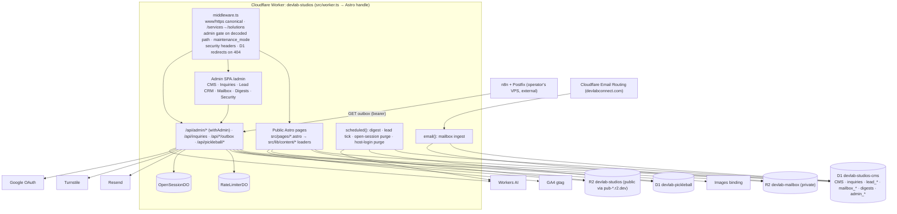
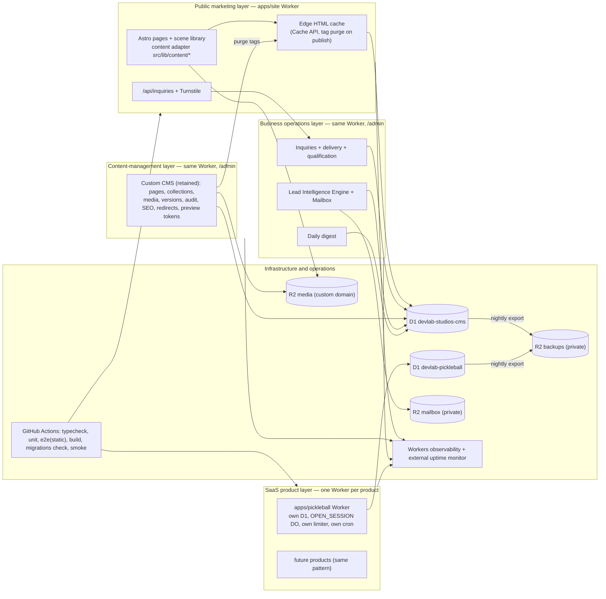

# DevLab Studios — B2B Transformation, CMS Modernization and Implementation Architecture Audit

**Document type:** audit findings and implementation specification for a Claude Opus implementation session.
**Repository:** `sabawstack/devlab-studios` at `main` commit `93a5a35` (version 2.2.0, 2026-10-13). **Production:** https://www.devlabstudios.com. **Audit date:** 2026-11-12.
**Status:** audit and planning only. No code, content, configuration, data or deployment was changed. This file is the single artefact produced; it is not committed.

**Evidence standard.** VERIFIED = directly read from the repository at the commit above or observed on the live site on the audit date (with `file:line` or URL). INFERRED = a conclusion from verified facts. HYPOTHESIS = needs market or owner validation. UNKNOWN = not accessible to this audit. Third-party product facts were read from vendor documentation, repositories, licence files, registries and pricing pages on the audit date by research agents working in this session; their sources are cited inline. Visual rendering of the live site could not be inspected (no browser available in the session); visual findings are therefore derived from tokens, components and served HTML and are marked accordingly.

**Contents.** A. Executive decision · B. Current-state inventory · C. Evidence-based website audit (including the founder-profile strategy) · BRAND. Premium Brand Identity, Original Visual Storytelling & B2B Experience · D. CMS decision report · E. CMS retention and conditional migration specification · F. Recommended B2B positioning · G. Public website information architecture · H. SaaS and company architecture · I. Target technical architecture · J. Opus implementation backlog · K. Validation and test specification · L. Migration and release safeguards · M. Costs and trade-offs · N. Unresolved decisions · O. Final implementation handoff.

---

## A. Executive decision

**Overall condition.** The site is a well-engineered Astro 7 application on Cloudflare Workers with a custom D1-backed CMS, a persist-before-deliver inquiry pipeline, a hardened admin, an extensive unit and end-to-end test base, a dormant lead-intelligence engine, a live inbound mailbox and a free sports product, all in one Worker. The engineering discipline is above average for a studio site: Zod at every boundary, versioned content with re-validated rollback, an audit log, careful security headers, isolated preview and production. The buyer-facing experience does not yet reflect that discipline.

**Primary B2B weaknesses (all verified).** (1) Server response time of 2–11 seconds on every page, because each request renders server-side with at least eight sequential D1 reads and no HTML caching. (2) A visual identity assembled from the patterns that now signal "AI-generated agency template": magenta-violet gradient, glass cards, floating icon fields, orbit rings, a decorative node canvas, a single default typeface. (3) Copy density roughly double what a buyer will read (1,659 words and 15 h2 on the home page, duplicated headings and propositions across pages). (4) Identity inconsistencies that cost trust: a personal Gmail address and a portfolio-era tagline in the footer, a street-level home address on the profile, an Organization schema without address, email or founding date, a legacy `alternateName` and a fake site-search action in structured data. (5) A proof surface with no client names, testimonials or outcomes, next to a claim that listed projects are "real builds, not illustrative examples" while four of them are landing-page templates. (6) An entry offer with no page, deliverable definition or booking step, and no recurring service. (7) A free consumer product occupying the middle of the business journey and 75% of recent engineering effort.

**Most important opportunities.** Fix the response time (a bounded engineering change with the largest measurable effect on rankings and conversion); give the studio a distinctive, technically authentic identity that explains operational problems visually and halves the copy; turn the audit into a real offer and define a recurring operations service; make the write-ups the proof surface with diagrams and real screenshots; and clean every identity signal so that an international buyer sees one coherent business.

**CMS recommendation.** Retain the custom CMS (Option A). On the weighted matrix EmDash edges it (4.00 against 3.70), but the business problem is presentation, not editing; the content load is one editor and fifteen articles; zero data loss is easiest by not migrating; EmDash is weeks past 1.0 with an undocumented shared-database story and a draft-save defect; and the redesign requires new content blocks in code regardless of store. Three reachable CMS defects (page rollback returns 404, an `archived` option the database rejects, Solutions and Insights editors that cannot save) are fixed, a draft preview token and a markdown preview are added, and a content-adapter boundary is enforced so that EmDash (second-best, Option D) can be adopted later as a loader change when the stated trigger conditions are met. Payload, Directus, Strapi and Keystatic are rejected for this stack and operating model.

**Target architecture.** Five layers with explicit boundaries: a public marketing layer (redesigned Astro pages behind an edge HTML cache), a content-management layer (the retained custom CMS in `/admin`), a business-operations layer (inquiries, lead engine, mailbox, digests in the same Worker, unchanged in guarantees), a product layer (one Worker per product, starting by moving DevLab Pickleball into its own Worker in the same repository with its own database, Durable Objects, limiter and cron), and an infrastructure layer that gains what is missing today: CI that runs the tests, observability and alerting, nightly backups, migration checks, a custom media domain and a production smoke test.

**Key implementation risks and safeguards.** Art production is the critical dependency of the redesign and is ordered first; the home and solutions pages cannot pass acceptance without the symbol library and six scenes. Edge caching must never serve drafts or admin content; cache policy is tested. The product-Worker split must respect Durable Object state keyed by Worker name; the cutover plan waits for sessions to expire. Retention jobs run only after automated backups exist and after an attended dry run. Every public URL in today's sitemap is frozen as a fixture and crawled after every production deploy. All production data writes are targeted, idempotent, preview-first and owner-authorised.

**Readiness.** The specification in Sections J–O is ready for implementation. Fourteen decisions in Section N belong to the business owner; none blocks the first requirements (CI gates, guard tests, CMS defects, tokens and scene library), and defaults are stated for each.

---
## B. Current-state architecture inventory

Everything in this section was verified from the repository at `main` (commit `93a5a35`, version 2.2.0, 2026-10-13) or from the live production site on 2026-11-12 unless marked otherwise.

### B.1 One Worker, five systems

The production deployment is a single Cloudflare Worker (`devlab-studios`) built from one Astro 7.3.8 application with `output: 'server'`, the `@astrojs/cloudflare` 14.3.4 adapter and a custom entrypoint `src/worker.ts` that delegates `fetch` to Astro and adds `scheduled`, `email` and `queue` handlers plus Durable Object exports. That one Worker hosts five logically distinct systems:

| System | Public surface | Admin surface | Data | State |
|---|---|---|---|---|
| Public marketing site | `/`, `/solutions`, `/work`, `/insights`, `/about`, `/profile`, `/contact`, `/process`, `/offers/*`, `/privacy`, `/terms`, sitemap, robots | — | D1 `DB` CMS tables + `src/data/*` static fallback; R2 `MEDIA_BUCKET` | Live |
| Custom CMS | — | `/admin` (React 19 SPA) and `/api/admin/*` | D1 `DB`: `pages`, `page_sections`, `projects`, `project_gallery_images`, `articles`, `resources`, `service_groups`, `faqs`, `certifications`, `experiences`, `skills`, `tools`, `workflow_items`, `navigation_items`, `site_settings`, `seo_metadata`, `redirects`, `media_assets`, `content_versions`, `audit_log`; R2 `MEDIA_BUCKET` | Live |
| Business inquiry pipeline | `/api/inquiries`, `/api/contact`, `/api/lead-magnet`, Turnstile | `/admin/leads` ("Inquiries") | D1 `DB`: `leads`, `delivery_attempts`, `lead_attribution`, `lead_consents`, `lead_activities`, `confirmation_recipients`; Resend; optional webhook | Live |
| Lead Intelligence Engine + Mailbox | `/r/[token]` tracked redirects; `/api/lead-engine/outbox*` and `/api/mailbox/outbox*` (bearer-token endpoints for an external n8n transmitter); Cloudflare Email Routing → `email()` handler | `/admin/lead-crm/*` (10 screens), `/admin/mailbox` | D1 `DB`: 22 `lead_*` tables, 5 `mailbox_*` tables; R2 `MAILBOX_BUCKET` (private); Workers AI; Brave/Nominatim/Overpass | Engine: deployed, runtime flags default off, campaign schedules ceiling off. Mailbox: live for `devlabconnect.com` per docs (routing rules dated 2026-09-20/23) |
| DevLab Pickleball (free product) | `/pickleball/*`, `/api/pickleball/*`, WebSocket `/pickleball/rt/open/[code]` | none (hosts self-serve) | D1 `PICKLEBALL_DB` (own migrations dir); `OPEN_SESSION` Durable Object; Google OAuth; Resend for DUPR export email | Live |

Shared by all five: the `RATE_LIMITER` Durable Object, `src/middleware.ts` (canonical host, admin gate, maintenance mode, security headers, 404 redirects), the single admin identity and session cookie, the daily cron (`0 22 * * *` UTC) that runs the Insights digest, the lead-engine tick and two pickleball purges as four independent `waitUntil` tasks, and one deploy pipeline.

### B.2 Dependency map

### B.3 Table ownership in D1 `devlab-studios-cms` (binding `DB`)

| Group | Tables (migration) | Cross-group links |
|---|---|---|
| Marketing CMS | `projects`, `media_assets`, `pages`, `page_sections`, `service_groups`, `faqs`, `experiences`, `skills`, `tools`, `workflow_items`, `seo_metadata`, `navigation_items`, `site_settings` (0001); `project_gallery_images` (0002, 0007); `articles`, `resources` (0003, 0004); `testimonials`, `case_studies`, `certifications`, `redirects`, `content_versions` (0004) | `site_settings.maintenance_mode` and `redirects` are read by the global middleware |
| Shared audit | `audit_log` (0004) | Written by CMS routes, inquiry admin routes, 14 lead-CRM routes, digests and password change; polymorphic `entity_type/entity_id`, no FKs |
| Admin auth | `admin_session_revocations` (0008), `admin_credentials` (0010, empty until first password change) | none |
| Inbound inquiries | `leads` (0006, 0009), `delivery_attempts`, `lead_attribution`, `lead_consents`, `lead_activities` (0009), `confirmation_recipients` (0017) | `lead_tracking_events.inbound_lead_id` references `leads.id` by value (no FK) |
| Lead Intelligence Engine | 22 `lead_*` tables including `lead_leads`, `lead_companies`, `lead_contacts`, `lead_outreach_drafts`, `lead_jobs`, `lead_tracking_*`, `lead_settings` (0012, 0013) | all FKs intra-group |
| Mailbox | `mailbox_threads`, `mailbox_messages`, `mailbox_attachments`, `mailbox_outbound`, `mailbox_outbound_attachments` (0014–0016) | hard FKs into `lead_leads` and `lead_outreach_drafts`; runtime joins in `src/mailbox/services/correlate.js` |
| Digests | `digests`, `digest_items` (0011) | read by public `/insights` pages |

Neither the lead engine nor the mailbox references any CMS table (verified by grep). The CMS tables can be moved or replaced without touching the operational groups provided four coupling points are handled: the shared `audit_log`, the middleware's `maintenance_mode` and `redirects` reads, the single admin session, and the fact that `media_assets`/`MEDIA_BUCKET` are CMS-only (safe to move).

### B.4 Environments and deployment

- **Production**: Worker `devlab-studios`, served only on `www.devlabstudios.com` (`workers_dev: false`, `preview_urls: false`), deployed by Cloudflare Workers Builds on push to `main` (documented; not verifiable from the repository).
- **Preview**: Worker `devlab-studios-preview` on `*.workers.dev`, separate D1 (`devlab-studios-cms-preview`, `devlab-pickleball-preview`), separate R2 buckets, separate secrets, `X-Robots-Tag: noindex, nofollow` confirmed live. Deployed by `.github/workflows/deploy-preview.yml` on push to `development` with `CLOUDFLARE_ENV=preview` at build time.
- **CI** (`.github/workflows/ci.yml`): lint, build, `audit-ci`, release tagging on version bump. It does not run `astro check`, the 169-file Vitest suite or any Playwright project; those run only by hand. D1 migrations are applied manually in both environments; nothing in CI applies or checks them.
- **Branches**: `main` and `development` plus `feat/lead-intelligence-engine` and 16 open Dependabot branches on origin.

### B.5 Runtime characteristics measured on production

| Measurement (2026-11-12, US-East vantage, 3 runs) | Result |
|---|---|
| Time to first byte, `/` | 4.3 s, 6.3 s, 10.8 s |
| Time to first byte, `/solutions` | 3.3 s, 7.3 s, 10.8 s |
| Time to first byte, `/profile` | 2.3 s, 2.4 s, 2.6 s |
| Time to first byte, `/insights` | 2.8 s, 3.9 s, 4.4 s |
| Time to first byte, `/contact` | 1.8 s, 2.2 s, 6.1 s |
| Preview `/` | 4.2 s |
| HTML size `/`, `/solutions`, `/work`, `/insights`, `/profile` | 94 KB, 100 KB, 107 KB, 101 KB, 314 KB |
| `Cache-Control` on HTML pages | absent |
| `Cache-Control` on `/_astro/*` assets | `public, max-age=31536000, immutable`, `cf-cache-status: HIT` |
| `/api/health` | `{"ok":true,"hasDb":true,"hasMediaBucket":true}` |

The slow first byte is VERIFIED from one vantage point. The cause is INFERRED from code: every public page is server-rendered on every request with no HTML caching, and the home page alone performs at least eight sequential awaited D1 reads (`loadPageSeo`, `loadPage('home')`, `loadPage('work')`, `loadProjects`, `loadArticlesContent`, `loadSiteSettings` in the layout, the maintenance-mode read in middleware, and the per-block loads inside `BlockRenderer.astro`), each a round trip from the edge location to the single D1 primary. The 2026-08-04 Lighthouse baselines in `docs/performance/` predate the Astro rebuild and measure a different architecture; they are not evidence about the current site.

### B.6 Documentation drift (summary)

`docs/CURRENT_STATE.md` (2026-09-17) predates releases 2.0.0–2.2.0 and the pickleball retirement; `docs/testing.md` lists two Playwright projects where five exist; `docs/security.md` still names Zoho CSP hosts and says preview is unprovisioned; `docs/guides/PRODUCTION_DEPLOYMENT_GUIDE.md` and `docs/guides/CMS_IMPLEMENTATION_GUIDE.md` describe a Hono Worker that no longer exists; `docs/security/SECURITY_AUDIT_REPORT.md` audits the pre-Astro SPA; `package.json` still has a `lead-engine:zoho` script whose file was deleted; `.env.example` lists nine `ZOHO_*` keys and omits the five admin and outbox secrets. The current code, `wrangler.jsonc`, `CHANGELOG.md` and the live site were treated as the source of truth throughout this audit.

## C. Evidence-based website audit

Each finding carries an ID, status (VERIFIED / INFERRED / HYPOTHESIS / UNKNOWN), evidence, impact, severity (Critical / High / Medium / Low), confidence and disposition. Live evidence is from production on 2026-11-12; code evidence is `file:line` at commit `93a5a35`.

### C.1 Commercial positioning

| ID | Finding | Status | Evidence | Impact | Sev. | Conf. | Disposition |
|---|---|---|---|---|---|---|---|
| BUS-F01 | The proposition is clear but mechanism-led; the hero and most sections explain how systems are built rather than what changes for the buyer | VERIFIED | live `/` hero and sections; 1,659 words | Buyers must work to translate; longer time to the CTA | High | High | Rewrite per Section F and BR.3 |
| BUS-F02 | Four "solution categories" are presented as peers although the first is a special case of the third; the audit is both a category and the entry offer | VERIFIED | `src/data/solutionsContent.js:18-110`; live `/solutions` | Choice overload; weak category pages for search | Medium | High | Three service lines + the audit as an offer (G.1) |
| BUS-F03 | No standardised productised or recurring offer exists; the only defined offer is the audit, with no page, deliverable format or booking step | VERIFIED | `src/config/offers.js:30-45`; `/solutions#workflow-systems-audit` anchor only | No recurring revenue path; weak conversion from "interested" to "started" | High | High | Audit page + retainer definition (F.4, BUS-02/03) |
| BUS-F04 | `/solutions` states "the related projects under each category are real builds, not illustrative examples" while four listed projects under Custom Software are landing-page samples whose own descriptions say "sample" and whose live URLs are `/landing-sample-*` | VERIFIED | `src/data/projectRecords.js` (w1–w6, `:48`); live `/solutions` | Credibility risk: a buyer who clicks sees a template | High | High | Remove samples from buyer pages or relabel as "starter templates"; retire legacy sample routes (WEB-07) |
| BUS-F05 | Proof surface has zero testimonials, logos, named clients or metrics; proof consists of write-ups, certifications and the founder's history | VERIFIED | counts across five pages | Normal for a studio founded 2026-03-02; the write-ups must therefore carry more weight | Medium | High | Case-study depth with diagrams and screenshots (WEB-05); no invented proof |
| BUS-F06 | The free Pickleball product occupies an h2 section in the middle of the home journey, a block on `/solutions`, the footer "Products" column and four indexable URLs | VERIFIED | `src/pages/index.astro:307-327`; `solutions.astro:352-385`; sitemap | Mixes a consumer product into the B2B journey; dilutes topical focus | Medium | High | Move to `/products` and footer; keep indexable at lower priority (G.1, SEO-07) |
| BUS-F07 | The brand name has no visible search presence and collides with several unrelated "DevLab"/"Dev Lab Studio" entities (game developers, an Android publisher, a ThemeForest seller) | INFERRED | WebSearch 2026-11-12 (non-Google index); Search Console access UNKNOWN | Discoverability by name is weak; the brand depends on distinctiveness of identity | Medium | Medium | Brand system (Section BRAND); Organization schema and sameAs cleanup (SEO-04); confirm in Search Console (Section N) |
| BUS-F08 | Ideal customer is stated as "service businesses, operators, founders, and small teams" with no industry or geography pages | VERIFIED | live `/about` FAQ | Cannot rank or convert on industry intent | Medium | High | ICPs in F.3; industry pages only when evidence exists |

### C.2 UX, UI and visual design

| ID | Finding | Status | Evidence | Impact | Sev. | Conf. | Disposition |
|---|---|---|---|---|---|---|---|
| UX-F01 | The visual system is built from the generic patterns the brief names: magenta-violet-blue gradient, glass cards (28 uses), backdrop blur (15), floating icon fields (30), orbit rings, radial glows, rounded cards (102), a decorative node canvas with a "System online" pulse | VERIFIED (code); rendered appearance UNVERIFIED | `src/index.css`, `GlassCard.jsx`, `PublicBackdrop.astro`, `VectorField.astro`, `LivingSystems.astro`, grep counts | Site reads as a template; weak memorability | High | High | New identity (BRAND) |
| UX-F02 | Copy density: home 1,659 words with 15 h2 and 24 h3; five sections carry duplicate h2 pairs; "Overview" eyebrow hard-coded on every section | VERIFIED | live HTML; `SectionHeader.jsx:8` | Scanning fails; headings mislead assistive tech and search | High | High | BR.3 targets; UX-05 |
| UX-F03 | Typography is a single Google-Fonts sans (Plus Jakarta Sans) with no hierarchy device beyond size | VERIFIED | `Layout.astro:49-52` | Undistinguished; external font origin on the critical path | Medium | High | BR.10 type system; self-hosting |
| UX-F04 | No skip link; 50 of 61 images on `/profile` are informative but have empty alt; 49 lack `loading` attributes | VERIFIED | live HTML | Accessibility and performance | Medium | High | BR.12; PROF-03 |
| UX-F05 | Contrast, spacing rhythm as rendered, animation smoothness and mobile menu behaviour could not be visually verified in this session | UNKNOWN | no browser available | — | — | — | First task of the implementation session: baseline screenshots at 390/820/1440 (TEST-04) |
| UX-F06 | The contact form is a good two-step design with typed inquiries; the single select mixes buyer options with "Employment opportunity" and "Contract or technical collaboration" | VERIFIED | live `/contact`; `src/lib/schemas/inquiry.ts:21` | Minor confusion; employment surfaces in the buyer path | Low | High | Split the select into two groups; employment link in footer and profile (LEAD-03) |

### C.3 Content and SEO

| ID | Finding | Status | Evidence | Impact | Sev. | Conf. | Disposition |
|---|---|---|---|---|---|---|---|
| SEO-F01 | Time to first byte on every server-rendered page is 2–11 s from a US vantage; HTML carries no `Cache-Control`; home performs at least eight sequential D1 reads per request | VERIFIED (measurement), INFERRED (cause) | B.5 table; `index.astro:37-41`, `Layout.astro:17`, `middleware.ts:80-86`; no cache headers | Fails Core Web Vitals site-wide; harms rankings and conversion | Critical | High | OPS-01 edge cache + read consolidation |
| SEO-F02 | Identity inconsistencies: footer shows a personal Gmail address and a legacy portfolio tagline; `/profile` shows a barangay-level address and postal code; Organization schema has no address, email or founding date; Person schema carries `alternateName: "AgustinezTechVA"`; `WebSite` schema advertises a `SearchAction` for a search that does not exist; the privacy page lists a different form than the live one | VERIFIED | `Footer.astro:53-56`, `src/data/siteSettingsContent.js:22-24`, `src/data/about.js:7-10`, `src/config/schema.js:6`, live JSON-LD, `src/data/pages/privacy.js` | Trust and E-E-A-T; personal data exposure | High | High | SEO-04, SEC-03, PROF-02 |
| SEO-F03 | `src/data/about.js` holds the founder's street address, phone and date of birth; only the address renders, but the data ships in the repository and bundle | VERIFIED | `src/data/about.js:7-10` | Personal data hygiene | Medium | High | Remove from code; city-level only (PROF-02) |
| SEO-F04 | Titles and descriptions: five titles over 60 characters (up to 85), seven descriptions over 160 (profile 248), three different separators | VERIFIED | live metadata table in the SEO report | CTR and truncation | Medium | High | SEO-01 |
| SEO-F05 | `og.png` is 1.37 MB; six pages pair a square logo with `summary_large_image`; `/insights/daily` and `/crawler` have no OG image; Article schema lacks `image` and `dateModified` | VERIFIED | live `<meta>` and file size | Broken or slow social previews; no article rich results | Medium | High | SEO-02 (OG template), SEO-03 |
| SEO-F06 | `/insights/daily` is an indexable rolling seven-day aggregator of third-party headlines with no archive; the home page links to it | VERIFIED (content), INFERRED (ranking risk) | `src/worker/digest/feeds.js:41`; live page | Thin-content risk; dilutes the Insights hub | Medium | Medium | `noindex, follow`; keep for visitors (SEO-06) |
| SEO-F07 | `/offers/lead-intake-checklist` is indexable with copy duplicated from the article it emails; `/crawler` is indexable without an h1; `/work/[slug]` serves an empty collection; `Layout.astro` emits `robots: index, follow` on 404 and noindex pages | VERIFIED | SEO report §1–2; `Layout.astro:41` | Index hygiene | Low | High | SEO-06, WEB-05 |
| SEO-F08 | Internal linking: "Profile" in primary nav with a meta description "Open to remote employment…"; `/contact` body links to the employment path; `/process` reachable from no nav or footer; `/work` does not link to the founder | VERIFIED | live HTML | Buyer and recruiter paths blur; orphaned page | Medium | High | G.2, PROF-01, LEAD-03 |
| SEO-F09 | Content library: 15 articles, 10 buyer-problem and 5 generic AI commentary; nothing published since 2026-09-15; the daily digest is the only fresh content | VERIFIED | `src/data/insights/*.js`; sitemap lastmod | Weak freshness and topical authority on buyer problems | Medium | High | Content architecture (SEO-08) |
| SEO-F10 | Cloudflare Web Analytics is allowed in CSP but not injected; GA4 ID is hard-coded in two layouts; no consent banner; privacy page omits first-party attribution storage | VERIFIED | SEO report §7.6, §9; `Layout.astro:64`, `LegacyAppShell.astro:65` | Measurement gaps for ad-blocked technical visitors; a hard-coded admin-changeable value; disclosure gap | Medium | High | OPS-05, SEC-03 |
| SEO-F11 | Search Console and GA4 data were not available to this audit | UNKNOWN | no access | Baseline conversion and ranking figures are unknown | — | — | Section N |

### C.4 Forms, inquiry pipeline and funnel

| ID | Finding | Status | Evidence | Impact | Sev. | Conf. | Disposition |
|---|---|---|---|---|---|---|---|
| LEAD-F01 | Inquiries are persisted to D1 before any delivery; the visitor's success response is decided by the write; every delivery attempt is recorded with an error category; admin retry skips succeeded targets; confirmation emails are capped per address | VERIFIED | `src/worker/inquiryService.js:240-331`, `src/worker/leadDelivery.js:169-301`, `migrations/0017` | This is the guarantee the brand is built on; it works | — | High | Preserve (Section L) |
| LEAD-F02 | Per-IP rate limit on inquiries fails open if the limiter binding is missing or errors; Turnstile fails closed | VERIFIED | `src/worker/rateLimit.js:101,110`; `turnstile.js:17` | Acceptable by design, documented; Turnstile remains the hard gate | Low | High | Keep; note in L |
| LEAD-F03 | Qualification is deterministic with stored reasons and tiers (priority ≥ 85, standard ≥ 55, nurture ≥ 25, else review); employment, partnership and general are unscored | VERIFIED | `src/lib/leads/qualification.ts:112-213` | Good; thresholds are code constants rather than settings | Low | High | Move thresholds to `lead_settings`-style config (LEAD-04) |
| LEAD-F04 | Funnel events exist (CTA click, form start, step, submit, persisted, resume download) with first-touch and UTM attribution stored per inquiry | VERIFIED | `src/lib/analytics.ts`, `analyticsBootstrap.ts`, `InquiryForm.jsx:216,314`, `migrations/0009:85-115` | Measurement is better than most studio sites; the gap is reporting, not capture | — | High | Funnel report in admin (LEAD-05) |
| LEAD-F05 | No scheduling or booking step exists anywhere; no scheduling tool is referenced in code or docs | VERIFIED | grep across `src` and `docs` | Consultation step is email-only | Medium | High | Decision in Section N; LEAD-06 conditional |
| LEAD-F06 | The webhook provider sends `LEAD_WEBHOOK_SECRET` verbatim as `X-DevLab-Signature` rather than an HMAC | VERIFIED | `src/worker/delivery/providers.js:100` | Misleading name; low risk while unset | Low | High | SEC-06 |
| LEAD-F07 | Human follow-up state lives in `/admin/leads` (pipeline status, owner, notes); there is no SLA timer, reminder or digest of unanswered inquiries | VERIFIED | `src/pages/api/admin/leads/*`, `LeadsPage.jsx` | First-response time cannot be measured or enforced | Medium | High | LEAD-05 |

### C.5 Technical implementation

| ID | Finding | Status | Evidence | Impact | Sev. | Conf. | Disposition |
|---|---|---|---|---|---|---|---|
| OPS-F01 | CI runs lint, build and `audit-ci` only; neither `astro check`, the Vitest suite nor any Playwright project runs in CI or in Git hooks | VERIFIED | `.github/workflows/ci.yml:32-39`; `.husky/*` | The 2,000+ tests protect nothing automatically | High | High | OPS-02 |
| OPS-F02 | No Workers observability, logpush, error reporter, alerting, or health check that touches D1 or Durable Objects; cron failures are only logged | VERIFIED | `wrangler.jsonc` (no `observability`); `src/pages/api/health.ts` | Outages and broken jobs go unnoticed | High | High | OPS-03 |
| OPS-F03 | No automated backup of D1 or R2; the disaster-recovery doc says so and asks for `backups/` to be gitignored, which it is not | VERIFIED | `docs/lead-engine/disaster-recovery.md:109,163-165`; `.gitignore` | Recovery depends on D1 Time Travel windows | High | High | OPS-04 |
| OPS-F04 | D1 migrations are applied by hand in both environments; no CI step applies or verifies them | VERIFIED | `deploy-preview.yml`; `docs/operations.md:103,114` | Code can ship ahead of schema | Medium | High | OPS-06 |
| CMS-F01 | Page versions cannot be restored (`pages` missing from the rollback registry → 404) although the UI offers Restore | VERIFIED (code) | `rollback.ts:43-47`; `PageBuilderPage.jsx:116` | A promised safety net does not work | High | High | CMS-01 |
| CMS-F02 | Page editors offer `archived`, which the `pages` CHECK constraint rejects | VERIFIED (code) | `PageBuilderPage.jsx:10`; `migrations/0001:36,49` | Save error on a visible option | Medium | High | CMS-01 |
| CMS-F03 | The Solutions and Insights page editors cannot save (slug enum excludes them) | VERIFIED (code) | `singletons.ts:60`; `pages/[slug].ts:33`; `publicSurfaces.js:11,13` | Two primary pages are not editable | High | High | CMS-01 |
| CMS-F04 | `loadProjects` merges static projects absent from D1, so CMS deletions do not propagate publicly | VERIFIED | `src/lib/content/projects.ts:69-72` | CMS is not the source of truth for projects | Medium | High | CMS-02 |
| CMS-F05 | Per-item SEO fields in page, article and case-study schemas are never persisted; SEO lives only per route | VERIFIED | `pages.js:63-110`; `migrations/0003` | Articles cannot carry their own metadata | Medium | High | CMS-03 |
| CMS-F06 | Rich text is a plain textarea with heading and bullet markdown only; no preview before publish; no draft preview token | VERIFIED | `liteMarkdown.ts`; `ContentManager.jsx` | Editing friction; publish-and-see | Medium | High | CMS-04 |
| CMS-F07 | Content rows store absolute `pub-*.r2.dev` URLs; reference tracking matches exact strings | VERIFIED | `media.ts:109`; `mediaAssets.js:45-77,298-320`; seeds | A media domain change breaks references; the public R2 dev URL is discouraged for production by Cloudflare | Medium | High | OPS-07 (custom media domain with URL rewrite) |
| SEC-F01 | Single admin identity, no roles, no MFA; `role` is carried in the token but never checked | VERIFIED | `adminAuth.js:620`; grep | Acceptable for one owner; blocks a second operator | Medium | High | SEC-02 |
| SEC-F02 | Admin JSON bodies on ~10 write routes have no size cap (`readJsonBody`) | VERIFIED | `src/lib/http.ts:52-55` | Low (authenticated only) | Low | High | SEC-05 |
| SEC-F03 | `PICKLEBALL_TEST_AUTH_ENABLED` has no loopback guard, unlike the admin `disabled` mode | VERIFIED | `test-login.ts:17` | A mistyped variable could mint host accounts | Medium | High | SEC-04 |
| SEC-F04 | CSP `script-src` uses `'unsafe-inline'` for the GA bootstrap and JSON-LD; `img-src https:` is wide open | VERIFIED | `securityHeaders.ts:13-27` | Known, tracked gap | Medium | High | SEC-07 (nonce) |
| SEC-F05 | No retention or deletion path for inquiries, lead-engine prospect data, mailbox content, audit log or content versions; no DSAR tooling; privacy page predates the mailbox, lead engine, pickleball host accounts and first-party attribution; rights requests go to a personal Gmail | VERIFIED | SecOps report §8; `src/data/pages/privacy.js` | Compliance exposure under the PH Data Privacy Act (technical view; not legal advice) | High | High | SEC-03, SEC-08 |
| SEC-F06 | The lead engine has no sending code, but the operator's external n8n and Postfix can send collected drafts; the repository's "no auto-send" statements are true of the Worker only | VERIFIED | `integrations/n8n/*.json`, `docs/lead-engine/outbound-mail-infrastructure.md` | Governance must be stated accurately | Medium | High | Document; keep ceilings; Section L |
| SAAS-F01 | Pickleball shares the Worker, deploy pipeline, cron, rate-limiter namespace and CPU budget with the business site; 75% of commits since 2026-10-01 touched it | VERIFIED | `wrangler.jsonc:13-15`; `git log` | Shared blast radius; roadmap crowding | Medium | High | SAAS-01 |
| SAAS-F02 | Privacy page does not describe pickleball host accounts (Google identity, email, DUPR club ID, 30-day login), and migration `0020` application status in production is undocumented since the docs say "pending" | VERIFIED (docs) / UNKNOWN (D1 state) | `docs/pickleball/architecture.md:272`; `privacy.astro` | Disclosure gap; schema drift risk | Medium | Medium | SEC-03; OPS-06 |

### C.6 Founder discoverability (Section 10 of the brief)

| ID | Finding | Status | Evidence | Impact | Sev. | Conf. | Disposition |
|---|---|---|---|---|---|---|---|
| PROF-F01 | `/profile` is complete and indexable: name, role, summary, capabilities, education, certifications, experience, tools, selected work, résumé (200, 130 KB), LinkedIn, GitHub, availability; Person schema present | VERIFIED | live `/profile`; `src/config/schema.js` | The asset exists and must be preserved | — | High | Keep |
| PROF-F02 | Profile duplicates its own h1 as an h2, publishes a street-level address, uses a legacy `alternateName`, points `url` at the site root and `image` at the logo, and lacks `alumniOf`/`hasCredential` despite listing both | VERIFIED | live HTML; `schema.js:2-90` | Weaker entity signals; personal data exposure | Medium | High | PROF-02 |
| PROF-F03 | Profile HTML is 314 KB with 61 images (tool logos, certificates) and large inline data-URI SVGs | VERIFIED | live size; HTML | Slow on mobile for recruiters | Medium | High | PROF-03 |
| PROF-F04 | About, Home and Profile repeat the founder biography and stack lists | VERIFIED | live copy | Duplication | Low | High | G.1, BR.3 |
| PROF-F05 | Profile sits in the primary navigation and is reachable from footer, About and Home; the Work page does not link to it | VERIFIED | live HTML | Discoverability is good; the only gap is Work | Low | High | Keep in nav as "Profile" per the brief; add link from Work write-ups (PROF-01) |

**Founder profile strategy (deliverable for Section 10).** `/profile` remains the canonical, indexable professional page and stays in the primary navigation labelled "Profile". Its audience is recruiters, engineering leaders and collaborators; its primary actions are résumé and "Contact Stephen about a role", with "Selected work" linking to `/work/<slug>` write-ups rather than duplicating them. Business pages reference the founder once each with a photo, one sentence and a link; they never carry employment language. The Person schema is corrected (profile URL, portrait image, `alumniOf`, `hasCredential`, `worksFor` → Organization with `founder` back-reference, `sameAs` LinkedIn and GitHub) and the legacy `alternateName` removed. Address is city-level; the phone and date of birth are deleted from the data file. The page keeps every verified achievement and project; it loses only duplication and page weight (lazy images, descriptive alt text, logos as a compact list rather than 61 images).

## BRAND. DevLab Studios Premium Brand Identity, Original Visual Storytelling & B2B Experience

> **Amendment (2026-11-12, release 2.5.0).** The owner replaced the "Working Drawings" palette with the dark "Blueprint" direction: navy canvas, the logo gradient as the accent (through one token, never on text), Space Grotesk and JetBrains Mono, a sticky glass header, an interactive home page and the Node mascot. See [ADR 0014](../architecture/decisions/0014-blueprint-palette.md). The findings and the scene approach below stand; BR.10's paper/ink values, its "no gradients, no blur" rule and its "nothing loops" motion rule are superseded where ADR 0014 says so.

### BR.1 Current visual identity audit

**Evidence basis.** No browser or screenshot tool was available in this session (no Chrome, no installed Playwright browsers; installing one is outside the audit's authority). The visual audit therefore rests on the design tokens, component source, the rendered HTML of every public page fetched from production on 2026-11-12, and pattern counts across the public UI source. Two dated Lighthouse screenshots in `docs/performance/baseline-2026-08-04/` show the pre-rebuild site and were used only to confirm continuity of the visual system (the repository states the "dark-native visual system, tokens, components" were kept through the 2026-09-17 rebuild). Pixel-level judgments (contrast measurements, spacing rhythm as rendered, animation smoothness) are **UNVERIFIED** and are assigned to the implementation session as the first verification task (TEST requirements).

**What the system is (VERIFIED from `src/index.css`, `tailwind.config.js`, components):**

| Element | Current value | Evidence |
|---|---|---|
| Brand colour | Indigo `#4500ff`, with a 120° gradient `#c000ff → #7600ff → #1800ff` (magenta to violet to blue) as `--brand-gradient` | `src/index.css:11-17` |
| Surfaces | Dark navy stack `#060711 … #171b31` for public pages, light `#f5f5fc` elsewhere; radial purple/blue glows painted on `body` | `index.css:19-29, 79-85, 95-113` |
| Background texture | Two-layer radial dot mesh on `body::before` (disabled on public pages), plus `PublicBackdrop` with three orbit rings and seven floating tech icons (database, code, network, CPU, git branch, server, webhook) | `index.css:117-133`, `src/components/PublicBackdrop.astro` |
| Decorative motif | `VectorField` floating icon clusters by "motif" (fullstack, automation, data, editorial): 30 uses across public pages | grep count |
| Card language | `GlassCard`: `rounded-2xl border-white/15 bg-slate-950/70 backdrop-blur-xl shadow-glass hover:-translate-y-0.5` — 28 uses; `backdrop-blur` 15 uses; `bg-gradient-to-*` 26 uses; `rounded-2xl/3xl/[2rem]` 102 uses in public UI | `src/components/GlassCard.jsx`, grep counts |
| Hero device | `LivingSystems`: seven node cards (Visitor → Web Interface → API Service → Structured Data → AI Decision → Automation → Human Handoff) joined by animated lines with a pulsing "System online" status | `src/components/LivingSystems.astro` |
| Typography | Plus Jakarta Sans 400–700 from Google Fonts (print-media swap trick), no mono, no serif; section titles `text-3xl/4xl font-semibold` | `Layout.astro:49-52`, `SectionHeader.jsx` |
| Section header | Every section prints the uppercase eyebrow **"Overview"** followed by the h2; several sections render two h2s (a framing sentence and a label) | `SectionHeader.jsx:8-11`; live HTML (15 h2 on home) |
| Motion | `slideRight/Left`, `bounce-gentle`, `pulse-soft`, `rotate-smooth`, `float`, `fadeInScale`; reduced-motion media query present | `src/styles/animations.css` |
| Imagery | Two `` on home (logo, founder), 81 inline SVGs (icons); profile page 61 images (tool logos, certificates) | live HTML counts |

**Assessment against the brief's list of generic AI-agency patterns (judgment, grounded in the facts above):** the current system contains most of the listed tells: a purple-blue gradient as the brand device, glowing radial backgrounds, floating geometric decoration (orbit rings), icon-heavy decorative fields, glassmorphism cards throughout, rounded cards in every section, a floating "dashboard-like" node canvas whose "System online" status demonstrates nothing real, and a single sans typeface that is itself a widely used default. The independent benchmark (BR.4) found exactly these patterns in three AI-agency templates and one live AI agency site: dark surface, violet glow, `backdrop-filter` cards, hairline borders, 4–6 equal service cards and a four-step process graphic. The current DevLab home page also follows the template section order (hero → problems → services → proof → process → principles → resource → founder → FAQ → CTA).

What is **not** generic and must be kept: the copy discipline (no invented metrics, no banned phrases, plain statements of what the system does), the operational-problem framing, the honest proof standard on Work, and the founder's presence as a named, accountable person.

### BR.2 Generic or AI-looking patterns to remove (specific)

1. `--brand-gradient` and all 26 `bg-gradient-to-*` utilities in public components; replace with flat ink/paper surfaces and one accent (BR.10).
2. `GlassCard`, `backdrop-blur-*`, `shadow-glass/elevated`, and hover-lift translations; replace with the flat `Panel` and `Figure` components (BR.10).
3. `PublicBackdrop` orbits and floating icons, `VectorField` fields, the `body` radial glows and dot mesh.
4. `LivingSystems` as hero decoration; the diagram idea survives as Scene S5 ("Build in layers"), drawn once, captioned, and static.
5. `SectionHeader`'s hard-coded "Overview" eyebrow and the double-h2 pattern.
6. `rounded-2xl/3xl` as the default corner; the new system uses 2–6 px radii and square figures.
7. Google Fonts network dependency and Plus Jakarta Sans.
8. The `float`, `bounce-gentle`, `rotate-smooth`, `pulse-soft` keyframes in public pages.

### BR.3 Website copy and content-density audit

Word counts of visible copy per live page (links and navigation excluded) and the targets after redesign:

| Page | Words today | h2 / h3 today | Target words | Target structure |
|---|---:|---:|---:|---|
| Home | 1,659 | 15 / 24 | ≤ 800 | 6 sections, one h2 each, ≤ 2 sentences of body per section, one scene or figure per section |
| Solutions | 1,609 | 10 / 20 | ≤ 900 (index) | Three service lines + audit; detail moves to per-category pages |
| Work | 1,005 | 6 / 0 | ≤ 500 (index) | One card per project with problem, system, verifiable result; detail on `/work/<slug>` |
| About | 489 | 5 / 7 | ≤ 450 | Remove the FAQ that duplicates home; keep facts, values, founder link |
| Profile | 943 (+61 images) | 9 / 31 | ≤ 900 | Keep content; reorganise with a sticky in-page nav (already present) and collapse tool-logo walls into a compact list |
| Contact | 246 | 1 / 0 | ≤ 220 | Keep |
| Insights | 1,277 | 21 / 0 | ≤ 400 + cards | Cards carry titles and one line; the daily digest preview is demoted |
| Pickleball | 819 | 6 / 13 | unchanged | Product page, outside this redesign's scope except shell and tokens |

Specific copy problems found (VERIFIED from the live HTML):

- **Duplicated headings.** Home sections carry a framing sentence *and* a label as two h2s ("The problems these systems are built to remove" / "Operational problems DevLab Studios addresses"; "Four ways that gets solved" / "Solution categories"; "Systems already running" / "Featured work"; "How delivery works" / "Delivery approach"; "Questions people ask first" / "Frequently asked questions"). One h2 per section.
- **Repeated propositions.** "Persist before you deliver", "failures are visible" and "every workflow ends at a person" appear in the principles section, in the FAQ ("What happens if an integration goes down?"), on the contact page and on the solutions page. State the principle once on home with a figure; link to it elsewhere.
- **Process stated three times.** The four delivery phases appear on home, on `/solutions` and on `/process`. Keep one place (`/solutions` or `/about`) and redirect `/process`.
- **Founder repeated.** Home has a founder section plus two FAQ answers naming him; About has a founder note; Profile is the full page. On business pages, one short founder block with a photo and a link is enough.
- **Technology lists on buyer pages.** "React + Astro", "Java + Laravel", "SQL + D1", "n8n + Make" appear in the hero canvas and the founder block. Buyers do not choose on these; move stacks to `/work/<slug>` and `/profile`.
- **Legacy tagline.** The footer still says "Your Vision, Digitally Crafted — one solution at a time, always evolving", which is portfolio-era language inconsistent with the studio positioning; the footer also shows a personal Gmail address and "Lapu-Lapu City, Cebu, PH", and the profile page a street-level address line. Replace with `hello@devlabstudios.com` and "Cebu, Philippines".
- **Tone.** The copy avoids the banned phrases and reads as a careful engineer. The problem is quantity and repetition, not quality. The rewrite should cut, not re-voice.

Writing standard for the rewrite (binding for Opus and for CMS content): one idea per sentence; no sentence over 22 words in headings or lead paragraphs; verbs over nouns; no stack names on home or solutions index; no numbers that cannot be sourced; captions under every figure in plain words; a "technical detail" disclosure for the engineering audience rather than inline jargon.

### BR.4 International B2B design benchmarking (summary of the research report)

Fourteen sites were fetched live on 2026-11-12 and read at the HTML/CSS level (pixels could not be seen; typeface names were taken from live `@font-face` declarations where possible). The full reference table is reproduced in Appendix BR-A. The conclusions that shape DevLab's direction:

- **The credible engineering brands are typography-led, not decoration-led.** Oxide (Suisse Int'l + GT America Mono, "Fig. 1" captions on real hardware photos), Evil Martians (their own variable grotesk + mono, pure black ink, no shadows, dense fact lists), thoughtbot (Cosmica/PP Mori + JetBrains Mono used only for eyebrows, labels and buttons; a grid of real faces as the hero), 37signals (a numbered principles page, fluid type). None uses gradients or glass.
- **The mascot brands keep the character out of the hero.** Deno's dinosaur lives in a footer scene and as three tiny "peeking" SVGs between sections; GitHub's homepage uses Octocat zero times and its brand rules say "use sparingly… never for money, security, sales, enterprise offerings, apologies"; Fly.io's balloon appears only on blog and docs headers, drawn by one commissioned illustrator; PostHog is the exception and compensates with dense factual proof and a full-time in-house illustrator who bans AI-generated hedgehogs. Mailchimp's Freddie survived its acquisition only inside the logo.
- **The generic aesthetic is precisely identifiable.** Three Framer "AI agency" templates and one live AI agency site shared: an imperative hero formula ("Intelligent systems that never sleep"), dark surface with violet glow and `backdrop-filter` cards (300 occurrences in one template), vendor logos (Claude, Stripe, Notion) presented as a trust row, unattributed round statistics ("98% less manual work", "3× faster"), sample-company case studies ("Northwind"), 4–6 equal service cards, a four-step Audit → Build → Deploy → Manage graphic, FAQ accordions with empty answers, and Inter paired with Syne, Geist or Plex Mono.
- **Typefaces now read as template:** Inter, Roboto, Poppins, Manrope, Space Grotesk, Geist, Instrument Serif, Fraunces. Still open-licensed and uncrowded: Bricolage Grotesque (optical-size axis), Martian Mono, Commit Mono, Mona Sans, Newsreader, Source Serif, Literata.
- **Production models that fit a one-person studio:** one commissioned illustrator producing one header image per article (Fly.io); type-as-illustration (Oxide); a small SVG pose library with a written approval gate (PostHog); layered static WebP scenes plus small SVGs rather than Lottie or Rive (Deno).

Transferable patterns for DevLab: mono for eyebrows, labels, buttons and figure captions; "Fig." numbering on real screenshots of shipped systems; fact lists with sourced numbers; a numbered principles page; the founder's face rather than a mock dashboard; theme-aware asset pairs; descriptive alt text; fluid type; `size-adjust` font fallbacks. Not to be copied: any named character, any proprietary typeface, Oxide's green-on-black, the "Linear look".

### BR.5 Three original visual directions

All three directions share the non-negotiables already decided above: open-licensed self-hosted type, no gradients, no glass, no floating decoration, one accent colour, figures with captions, copy density targets, and the conversion IA in Section G. They differ in art direction.

#### Direction 1 — "Working Drawings"

- **Creative concept.** The website is set like an engineer's working drawing set: paper ground, ink lines, mono annotations, numbered figures, and one "redline" accent used only where something is marked, fixed or must be noticed. Every scene is a precise line drawing of a real operational situation (an inbox, a spreadsheet, a phone, a person with a name badge) that becomes a connected system. The metaphor is literal to the business: DevLab reviews a workflow, marks what is wrong, and draws the system that fixes it.
- **Brand personality.** Precise, calm, candid, slightly dry. The engineer who draws before building.
- **First impression.** "These people document things. This will be built properly."
- **Typography philosophy.** One variable grotesk with an optical-size axis for everything from display to text (Bricolage Grotesque); one mono for labels, eyebrows, captions, buttons and code (Martian Mono); a text serif only inside long-form articles and case studies (Newsreader). Large display is set tight and left-aligned, never centred, never gradient-filled.
- **Colour system.** Paper, ink, two greys, hairline, one redline accent, one diagram-only "connected" green. Dark panels (ink on paper inverted) for the hero band and footer only.
- **Composition and layout.** A 12-column grid with visible restraint: generous left margins, figures that break the text column, captions aligned to a baseline, numbered sections ("§1 Problems", "Fig. 03"). Whitespace is structural, not empty.
- **Illustrations and scenes.** Six core scenes (BR.8) drawn as line art with flat fills in paper tones, the accent reserved for the marked problem and its fix. Diagrams for case studies use the same stroke weight and symbols (a documented symbol library).
- **Mascot compatibility.** Medium-high: a line-drawn character in the same stroke language reads as part of the drawing set, not as a cartoon layer on top.
- **Motion philosophy.** Draw-in of diagram paths once, on first view, 400–700 ms; hover states change ink weight or underline, nothing moves. Reduced motion shows the finished drawing.
- **Component language.** Flat panels with 1 px hairlines and 4 px radii; figures with mono captions; fact lists; quiet and primary buttons in ink; forms with hairline fields and a redline focus ring.
- **Homepage treatment.** Ink hero band with the proposition and the founder's photograph cropped like a documentary portrait; Scene S1→S2 as the first figure; three service lines as a drawing index; Work as three captioned figures; one principles figure (S3); audit offer as a redlined drawing (S6); founder strip; final CTA.
- **Case-study presentation.** Each write-up is a drawing set: Fig. 1 the situation, Fig. 2 the system, Fig. 3 what it verifiably does (a real screenshot with annotations), followed by the narrative and a "technical notes" disclosure.
- **Commercial credibility.** High with operations managers and CTOs; good with owners because scenes depict their actual tools and people. International: culturally neutral and reads as engineering rather than agency.
- **Accessibility and performance.** Best of the three: SVG line art is small, scales to any width, inverts for dark panels, and carries real alt text; no blur or large raster assets; fonts ≈ 90–110 KB total.
- **Complexity and maintenance.** Lowest: a symbol library plus six scenes; new scenes are composed from the library; CMS content never requires new art.

#### Direction 2 — "Daylight Workshop"

- **Creative concept.** Warm, editorial, scene-led: fully illustrated "workshop" scenes with flat colour and soft paper grain show a small business team before and after their system, with a recurring character who walks through the workflow. Think of an illustrated field guide rather than a technical drawing.
- **Personality.** Warm, human, encouraging, approachable to non-technical owners.
- **First impression.** "Friendly, human, understandable."
- **Typography.** Grotesk + text serif pairing (Bricolage Grotesque + Newsreader) with the serif used for section leads to add warmth; mono only in code samples.
- **Colour.** Warm off-white, deep ink, a three-colour illustration palette (clay, sea green, ochre) that never appears in UI chrome.
- **Composition.** Alternating full-width scenes and text columns; scenes are the primary content of a section, copy is a caption.
- **Illustrations.** Eight to ten rich scenes plus spot illustrations; a character with ten poses.
- **Mascot compatibility.** Highest; the character is the narrator.
- **Motion.** Scene state transitions (before → after) on scroll or toggle; a two-frame approach, no continuous animation.
- **Components.** Soft panels with 8 px radii, warm hairlines, illustrated empty states.
- **Homepage.** Hero is a scene with the character and a short line; the rest alternates scenes and short text.
- **Case studies.** Illustrated "before/after" spread followed by screenshots.
- **Credibility.** Strong with owners and general visitors; weaker with CTOs unless every scene is paired with real screenshots, and at risk of reading like consumer SaaS (Notion-like) if the illustration becomes the whole identity.
- **Accessibility and performance.** Raster or complex SVG scenes at 60–150 KB each; requires careful art direction for contrast; needs `prefers-reduced-motion` handling for state transitions.
- **Complexity and maintenance.** Highest: a commissioned illustrator for the initial set and for every new section or offer; new case studies either reuse scenes or wait for art.

#### Direction 3 — "Signal and Structure"

- **Creative concept.** Typographic and photographic: very large, tightly set display type; black-and-white documentary photographs of the founder at work and of client-side operations (with consent); real product screenshots in flat frames with mono annotations; no illustration at all. Dark ink panels for emphasis sections against light content.
- **Personality.** Confident, spare, serious.
- **First impression.** "Serious engineering. Premium."
- **Typography.** Grotesk + mono (as Direction 1), used more aggressively (display sizes up to 96 px on desktop, uppercase mono labels).
- **Colour.** Ink, paper, one accent; photography is monochrome.
- **Composition.** Editorial magazine grid, full-bleed photographs, large numerals.
- **Illustrations and scenes.** None; diagrams only where unavoidable, drawn as mono text diagrams.
- **Mascot compatibility.** Low.
- **Motion.** Minimal, type-level transitions only.
- **Components.** Hairline panels, square corners, large figures.
- **Homepage.** Statement hero, three screenshots as proof, founder photograph, principles as numbered list, CTA.
- **Case studies.** Screenshot-led with annotations.
- **Credibility.** High with CTOs and international prospects; weakest for a non-technical owner because nothing explains the problem visually, and it leans on photography the studio does not yet have.
- **Accessibility and performance.** Photographs are the heaviest assets of the three directions; type-led pages are otherwise light.
- **Complexity and maintenance.** Medium: needs a photographer and ongoing photography for new work; without it the pages become type-only and close to the much-cloned dark SaaS look.

### BR.6 Recommended direction and rationale

**Recommendation: Direction 1, "Working Drawings", with the character programme from Direction 2 adopted as a secondary element under the charter in BR.7.**

Why: it is the only direction whose visual language *is* the service (reviewing, marking up and drawing systems), so the identity remains recognisable without the logo and independent of trend; it explains operational problems to a non-technical owner through familiar objects while reading as rigorous to a technical lead; its assets are small SVGs produced from a symbol library, so routine CMS updates never need new art; it performs and inverts for dark panels; it is internationally neutral; and it is the farthest from the violet-glow template aesthetic without being a copy of any benchmark (Oxide's ASCII and Evil Martians' width-play are deliberately not reused). Direction 2 is the better choice only if the business decides the primary audience is non-technical local owners and funds an illustrator; Direction 3 is the fallback if no illustration budget exists at all, at the cost of explanatory power.

What "premium" means for DevLab, in testable terms: a self-hosted type system with real optical sizing; a paper/ink palette with one accent used for meaning; figures with numbered captions; scenes that are technically accurate; copy under the density targets; 4 px radii and hairlines instead of glass; motion that only draws and never floats; and pages that look intentional at 390, 820 and 1440 px wide.
### BR.7 Mascot feasibility and concept evaluation

**Feasibility verdict first.** A recurring character is commercially appropriate for DevLab *only* as a secondary brand element governed by a written charter, produced by one human illustrator in the Working Drawings stroke language, and introduced after the core identity (type, colour, scenes) has shipped. It is not appropriate as the hero device or as the primary identity: every credible technical brand in the benchmark that keeps a character (GitHub, Deno, Fly.io) keeps it away from the hero, pricing, security and enterprise pages, and the one that leads with it (PostHog) has a full-time illustrator and dense product proof behind it. The business owner must approve the programme and its budget (Section N). If not approved, the identity stands without it.

Three original directions were developed. None is a robot, a brain, a lightbulb, a rocket or a copy of an existing tech mascot.

| | Concept 1 — "The Watchkeeper" (tarsier) | Concept 2 — "Steady" (carabao) | Concept 3 — "Relay" (abstract node-and-path figure) |
|---|---|---|---|
| 1. Concept and brand meaning | A small Philippine tarsier drawn in ink lines: enormous eyes, a steady grip. Meaning: nothing goes unnoticed; failures are visible; it holds on and does not drop the thread. Ties directly to the reliability principle "failures are visible, not silent" | A geometric carabao: broad shoulders, horns that form an open bracket. Meaning: carries the operational load reliably, steady under weight, unglamorous and dependable | A figure built from a node (head) and a path (body) with two terminals (hands). Meaning: the handoff that never fails; the connection between two systems made into a character |
| 2. Personality | Attentive, calm, quietly amused, never startled | Patient, strong, unhurried, kind | Precise, quick, helpful, a little formal |
| 3. Shape and silhouette | Round head, two large circles, small body, long fingers gripping an edge; reads at 16 px as two eyes and a curve | Trapezoid body, curved horn arc; reads at 16 px as the horn arc | Circle on a bent line with two end-caps; reads at 16 px but risks reading as an icon, not a character |
| 4. Visual style | Single-weight ink line, flat paper fills, one accent dot in the eyes when "noticing" something; same stroke as the scene library | Single-weight line with heavier contour; flat fills | Pure line, identical to diagram connectors |
| 5. Colour | Ink and paper; accent only for the "noticed" state | Ink and paper; accent on the bracket horns when "carrying" a marked item | Ink; accent on terminals when "connected" |
| 6. Link to engineering and automation | Observability, audit trails, retries, "someone is watching the queue" | Throughput, reliability, carrying load without complaint | Integration, message passing, handoffs |
| 7. Suitability for PH and international B2B | High: locally specific without being folkloric; internationally the tarsier is unfamiliar enough to be distinctive and is not a national cliché. Risk: "cute" if drawn softly; mitigated by the ink-line style | High locally; internationally it may read as agricultural or slow, which fights "precision engineering" | Neutral everywhere; weakest identity, closest to generic "connector" icons used by integration vendors |
| 8. Homepage use | Never in the hero. One small appearance at the seam before the principles figure (peeking at the "failure made visible" mark) and one in the footer | One appearance in the footer carrying the "systems running" figure | Section-seam appearances only |
| 9. Explanatory scenes | Appears in S3 and S4 as the observer and the hand-off recipient's assistant, pointing at the marked failure | Appears in S5 carrying layers | Appears as the connector in S2, risking confusion with real diagram connectors |
| 10. Docs and onboarding | Empty states, 404, article headers for Reliability/Handover topics, product guides (pickleball host guide) | Same | Same |
| 11. Animation potential | Eye-blink and head-turn as two-frame SVG swaps; a "notice" state (eyes widen, accent dot appears) | Minimal; a slow step | Path draw-in; terminals light up |
| 12. Accessibility | Decorative (`aria-hidden`) except where it carries meaning, then alt text names the state ("The watchkeeper points at the failed delivery attempt") | Same | Same |
| 13. Production and maintenance | 10 poses (idle, notice, point left/right, hold, peek top/side, wave, sleep-with-one-eye-open, read) as SVG from one illustrator; style sheet with stroke widths and eye geometry; dark-panel inversion; approval gate; no AI-generated versions | 8 poses | 8 poses; easiest to produce in-house |
| 14. Risk to credibility | Moderate if over-used or drawn cute; low under the charter | Moderate (cultural symbolism, "beast of burden") | Low risk, low reward |

**Recommendation:** adopt **Concept 1, "The Watchkeeper"**, under the charter below, as an approved-but-optional programme. It has the only genuinely conceptual link to what DevLab sells (visibility of failures, holding the thread), it is locally grounded without being a national emblem, and it is the most memorable silhouette. Working name only; the final name is a business decision.

**Charter (binding if adopted):** never in the hero, never on `/contact`, pricing, security, legal or inquiry screens; at most one appearance per page on business pages; allowed in article headers, empty states, the 404 page, docs and product guides, and in the footer; always in the Working Drawings stroke; never speaks in first person on business pages; every new pose goes through one approver; AI-generated renderings are not used in production; the character is `aria-hidden` unless it conveys meaning.

### BR.8 Visual storytelling and scene system

**Scene registry (code-owned; the CMS selects by `sceneId`, never uploads art).** Each scene is an SVG composed from a documented symbol library (inbox, chat bubble, phone, spreadsheet, sticky note, form, database ledger, API hexagon, automation gear-less "process" rounded rectangle, person with name badge, clock, warning mark, check mark, envelope, retry arrow, approval stamp). Line weight 1.5 px at 1× with 2 px for emphasis; corners 2 px; paper fills; redline accent only for the marked item; "connected" green only for verified-state marks in S2/S3.

| ID | Title | What it shows (technically accurate) | Placement | Dimensions / ratio | Budget | Alt / caption |
|---|---|---|---|---|---|---|
| S1 | Fragmented intake | Four inbound channels (web form, email, chat, phone) landing in four unconnected places; a sticky note with "who owns this?"; a clock past working hours | Home §Problems; `/solutions` lead-intake page | 3:2 desktop, 4:5 mobile crop | ≤ 24 KB SVG | "Inquiries arriving through four channels into four disconnected tools with no owner" |
| S2 | The connected system | The same four channels entering one ledger (record with status and owner), notifications to a named person, status visible | Home §Problems (as the second state of S1), `/solutions` | same | ≤ 28 KB | "The same inquiries recorded once, with a status and an owner" |
| S3 | Persist before deliver | A record written to the ledger first; then three delivery attempts (email ok, CRM ok, webhook failed with a redline mark and a retry arrow); an operator view listing the failure | Home §Reliability; `/solutions` audit page; Work write-ups where relevant | 16:9 | ≤ 24 KB | "The submission is saved first; the failed delivery is marked and can be retried" |
| S4 | Handoff to a person | An exception leaving the automated path to a person with a name badge and an approval stamp | `/solutions` automation page; article headers | 1:1 | ≤ 16 KB | "An ambiguous case routed to a named person for approval" |
| S5 | Build in layers | Five horizontal strata: interface, API, data, automation, handoff; labelled in mono; the strata connect with drawn joins (the honest successor to the hero node canvas) | `/solutions` custom-software page; `/about`; `/work/<slug>` template | 16:9 | ≤ 20 KB | "A system drawn as its layers: interface, services, data, automation and the people who operate it" |
| S6 | Workflow audit (redlined drawing) | A workflow drawing with redline marks numbered 1–3 and a short list "recommended, in priority order" | Home §Offer; `/solutions/workflow-systems-audit` | 3:2 | ≤ 24 KB | "A workflow reviewed and marked up, with a prioritised recommendation" |
| D-x | Case-study diagrams | One diagram per project drawn from the same library, describing the real architecture in that write-up | `/work/<slug>` | 16:9 | ≤ 30 KB each | Project-specific |
| OG | Social card template | Paper ground, title in grotesk, mono eyebrow, a small symbol from the library | all pages | 1200×630 PNG, ≤ 200 KB | n/a |

Responsive treatment: scenes are SVG with `viewBox` and two art-directed crops (wide and tall) selected with `<picture>`/`media` or CSS; captions are HTML, not baked into the art; text inside scenes is limited to labels that have a translation in the caption.

Fallbacks: if an SVG fails to load, the caption and a 1 px hairline frame remain (no layout shift because the frame has a fixed aspect ratio); when `prefers-reduced-motion` is set, draw-in animation is skipped and the finished scene is shown.

Photography: one documentary-style portrait of the founder (colour, natural light, workspace context, not a headshot on a gradient) at 3:4 and 1:1 crops, ≤ 120 KB each as AVIF/WebP. Real screenshots of shipped systems (the admin's inquiry list with synthetic data, the pickleball board, the audit log) in flat frames with mono "Fig." captions; never mock dashboards.

### BR.9 Page-by-page visual specifications

Each row states the target visitor, primary message, key visual, supporting copy limit, trust signal, primary and secondary CTA, next step and the conversion metric.

| Page | Visitor | Primary message | Key visual | Copy | Trust signal | Primary CTA | Secondary CTA | Next step | Metric |
|---|---|---|---|---|---|---|---|---|---|
| Home | Owner / ops manager; CTO | DevLab builds and runs the operational systems behind your business | Ink hero band: proposition + founder portrait; then S1→S2 | ≤ 800 words, 6 sections | Fig. of the site's own inquiry pipeline (S3); founder named once; Work figures | Discuss your system | See the work | Solutions or Work | hero CTA click rate; inquiry_submit from `/` |
| Solutions index | Buyer with a specific pain | Three service lines and one way to start | Drawing index: three small figures (S2, S4, S5) + S6 for the audit | ≤ 900 | "What you receive" lists | Category CTA (typed) | Request the audit | Category page | category CTA click; inquiry by type |
| Solutions / category | Buyer | What this system does for you, what it includes, proof | One scene + one Work figure | ≤ 600 | Linked write-up; included capabilities | Discuss (typed) | Read the write-up | Inquiry | inquiry by `solutionId` |
| Workflow Systems Audit | Buyer ready to start | A fixed-scope review with a written recommendation | S6 | ≤ 500 | Deliverable list; sample table of contents of the written output | Request the audit | Ask a question | Inquiry (`workflow_audit`) or booking | audit inquiries; booking rate |
| Work index | Buyer, CTO | Real systems, honestly described | Three to four captioned figures (D-x) | ≤ 500 | Evidence standard statement | Read the write-up | Discuss a similar system | Write-up | write-up views → inquiry |
| Work / slug | CTO, buyer | Problem → system → what it verifiably does | Fig. 1–3 sequence; real screenshot | ≤ 900 + technical disclosure | Diagram, screenshot, stack in disclosure | Discuss a similar system | Back to work | Inquiry with `case` | inquiry with `caseStudyId` |
| Insights | Owner, ops, technical | Problem-led thinking | Card grid with mono problem tags; article header art (scene or Watchkeeper) | ≤ 400 + cards | Dates, author | Read | Request the audit (sidebar) | Article | article → offer CTA |
| About | Buyer validating | Who we are, how we work, where we are | Founder portrait; S5; numbered principles list | ≤ 450 | Founding date, location, principles | Discuss your system | Founder profile | Contact or Profile | about → contact |
| Profile | Recruiter, technical lead | Stephen's background, work, availability | Portrait; compact capability list; selected-work figures | ≤ 900 | Experience, certifications, résumé | Download résumé | Contact Stephen (employment) | LinkedIn / résumé | resume_download; employment inquiries |
| Contact | Any | Describe the problem; a person reads it | None (form is the visual); S3 caption line "saved before anything else happens" | ≤ 220 | Persistence statement | Submit | — | Confirmation | form_start → persisted |
| Products | Any | What DevLab builds and runs itself | Pickleball real screenshot; "in exploration" list | ≤ 400 | Live product proof | Start a session | Register interest | Product | product CTA clicks |

### BR.10 Brand design tokens and component principles

**Typography (self-hosted woff2, OFL licences, subset to Latin):**

| Role | Face | Axes / weights | Use |
|---|---|---|---|
| Display and text | Bricolage Grotesque (variable: opsz 12–96, wdth 75–100, wght 200–800) | display at opsz 96 wght 600–700 wdth 90–100, tight tracking (−0.02em); text at opsz 12–14 wght 400–500 | all headings, body, UI |
| Labels, captions, buttons, code | Martian Mono (variable: wdth 75–112.5, wght 100–800) | wght 400–600, wdth 100; uppercase at 0.08em tracking for eyebrows and "Fig." captions | eyebrows, figure numbers, buttons, nav labels, form labels, code |
| Long-form | Newsreader (variable opsz) | opsz 16–20, wght 400 | article and write-up body only |

Fluid type scale: `--step--1: clamp(0.875rem, 0.84rem + 0.2vw, 1rem)`; `--step-0: clamp(1rem, 0.95rem + 0.3vw, 1.125rem)`; `--step-1: 1.25–1.5rem`; `--step-2: 1.5–2rem`; `--step-3: 2–3rem`; `--step-4: 2.75–4.5rem`; `--step-5: 3.5–6rem` (display only, ≤ 2 lines). Line heights 1.5 text, 1.1 display. Measure 60–72 characters. Font fallbacks declared with `size-adjust`/`ascent-override` to avoid layout shift; total font transfer ≤ 120 KB.

**Colour roles (no gradients, no alpha glass; dark panels invert the pairs):**

| Token | Light (paper) | Ink panel | Role |
|---|---|---|---|
| `--paper` | `#F6F3EC` | `#14130F` | page background |
| `--paper-2` | `#ECE8DF` | `#1E1C17` | secondary surface, table stripes |
| `--ink` | `#14130F` | `#F6F3EC` | text, primary buttons |
| `--ink-2` | `#3B3931` | `#D9D4C7` | secondary text |
| `--ink-3` | `#6E6A5F` | `#A6A092` | captions, metadata (meets 4.5:1 on paper) |
| `--rule` | `#D5D0C4` | `#2E2B25` | hairlines, frames |
| `--redline` | `#C8331B` | `#FF6A4D` | the single accent: marks, focus rings, the primary CTA hover underline, error states |
| `--ok` | `#2C6B4A` | `#6FBF93` | diagram-only "verified/connected" marks; success toasts |
| `--brand-legacy` | `#4500FF` | — | logo only, until the logo is reviewed (Section N) |

Contrast requirements: body text ≥ 7:1, secondary ≥ 4.5:1, mono captions ≥ 4.5:1, focus ring 3:1 against adjacent colours. The accent is never used for large fills or text under 16 px.

**Spacing and layout:** 4 px base; spacing scale 4, 8, 12, 16, 24, 32, 48, 64, 96, 128, 160; section rhythm `clamp(4rem, 8vw, 10rem)`; container 72 rem with 16 px gutters at phone width, 32 px at tablet, 48 px at desktop; 12-column grid from 1024 px, 6 columns 640–1023, 4 columns below; figures may span 8/12 and break the text column by 1–2 columns on desktop; captions hang in the margin column at ≥ 1280 px.

**Radii, borders, elevation:** radii 2 px (inputs, tags), 4 px (panels, buttons), 6 px (figures); borders 1 px `--rule`; no box shadows except a 1 px offset "paper lift" on hover for cards (`box-shadow: 0 1px 0 var(--rule)`); no blur.

**Component standards:**

- `Button`: primary (ink fill, paper text, 44 px min height, mono label), quiet (ink text, 1 px underline that turns redline on hover), icon-only never for primary actions; disabled at 40% ink.
- `Panel`: paper-2 surface or hairline frame; never both; title in grotesk, eyebrow in mono.
- `Figure`: frame + media + `figcaption` in mono "Fig. 03 — caption"; numbering is per page and auto-generated.
- `FactList`: numbered facts with a source; used for verifiable statements only.
- `ProofStrip`: up to four facts in a hairline row.
- `SceneFrame`: aspect-ratio box, lazy SVG, draw-in once, reduced-motion aware.
- `NavBar`: paper surface, 1 px rule at bottom, five items + primary button; mobile: full-height sheet, 56 px targets.
- `Footer`: ink panel; identity, columns, legal; no tagline.
- `Form fields`: 1 px rule, 48 px height, labels above in mono, helper text in ink-3, error in redline with icon and text, focus ring 2 px redline offset 2 px.
- `Disclosure` ("Technical notes"): mono summary row, 4 px radius, no animation beyond height.
- `Tag`: mono uppercase, 2 px radius, hairline.
- `Table`: hairlines only, paper-2 header.

**Motion principles:** durations 150–250 ms for UI, 400–700 ms for a single scene draw-in; easing `cubic-bezier(0.2, 0.7, 0.2, 1)`; only opacity, transform (translateY ≤ 8 px) and stroke-dashoffset animate; nothing loops; nothing floats; nothing animates on scroll except a one-time reveal; `prefers-reduced-motion: reduce` disables all of it and shows end states.

**Tokens as enforcement:** the public stylesheet must not contain `backdrop-filter`, `linear-gradient`, `radial-gradient`, `blur(`, `animation: float`, or `rounded-2xl/3xl` utilities in public components; a unit test greps the built CSS and the `src/components` (non-admin, non-pickleball) tree for these strings and fails on any occurrence (TEST requirements).

### BR.11 Asset production and maintenance strategy

| Asset | Production | Format | Owner | Rule |
|---|---|---|---|---|
| Symbol library (≈ 20 symbols) | Drawn once in a vector editor to the style sheet; committed as individual SVGs and as an SVG sprite | SVG, optimised (svgo), currentColor strokes | Engineer or illustrator | Every scene composes from the library; new symbols go through the same style sheet |
| Six scenes + OG template | Composed from the library; may be commissioned to one illustrator with the style sheet; AI-assisted drafts allowed only for exploration, never for production files, and every production file is human-drawn or human-edited and licensed to DevLab | SVG (scenes), PNG (OG) | Illustrator or engineer | Each scene has a wide and tall crop; captions live in HTML |
| Case-study diagrams | Composed per write-up by the engineer from the library | SVG | Engineer | Must match the described architecture; reviewed against the code or system |
| Founder portrait | One photo session (natural light, workspace) | AVIF/WebP + JPEG fallback, 3:4 and 1:1 | Photographer or self-shot with care | No gradient backdrops, no heavy retouching |
| Screenshots | Captured from real systems with synthetic data | WebP in `Figure` frames | Engineer | Never mock dashboards; mask any real personal data |
| Watchkeeper poses (if approved) | One illustrator, 10 poses, style sheet, approval gate | SVG | Illustrator | Charter in BR.7 |
| Fonts | Subset woff2 self-hosted in `public/fonts` | woff2 | Engineer | OFL licence files committed; `font-display: swap` with metric overrides |

Routine CMS updates (new article, new project, copy change) require no new art: articles choose a header from the scene set or a Watchkeeper pose by ID; projects choose a diagram from the registry or reuse S5 until a specific diagram is drawn.

### BR.12 Mobile and accessibility requirements

Breakpoints 390 (phone), 820 (tablet), 1440 (desktop) are the verification sizes; layouts must also hold at 320 and 1920. No horizontal scroll at any width; 16 px side gutters at phone width; tap targets ≥ 44 × 44 px; sticky header ≤ 64 px tall with the primary CTA visible on phones; menus and dialogs trap focus and close on Escape; a skip link to `main` on every page (absent today); one h1 per page, no skipped levels, eyebrows are `
`; informative images have descriptive alt text (the 50 empty-alt informative images on `/profile` are fixed); colour is never the only carrier of meaning (redline marks also carry a glyph or label); contrast as in BR.10; keyboard order matches reading order; forms announce errors with `aria-describedby`; motion respects `prefers-reduced-motion`; language attribute set; the daily digest's heading text no longer embeds "(opens on … in a new tab)".

### BR.13 Performance budgets and constraints

| Metric | Budget (mobile emulation, Lighthouse or WebPageTest) |
|---|---|
| Time to first byte (production, edge-cached HTML) | ≤ 600 ms at p75 from PH, US-West and AU test locations; cold/uncached ≤ 1.5 s |
| LCP | ≤ 2.5 s |
| CLS | ≤ 0.05 |
| INP | ≤ 200 ms |
| HTML document | ≤ 60 KB compressed (home); `/profile` ≤ 90 KB |
| CSS | ≤ 40 KB compressed |
| JavaScript on public pages | ≤ 60 KB compressed total; islands only where interactive |
| Fonts | ≤ 120 KB total, two families on business pages (serif loads only on article/write-up routes) |
| Images per page | ≤ 250 KB total above the fold; OG image ≤ 200 KB |
| Scenes | per-scene budgets in BR.8; lazy below the fold |
| Third-party requests | GA4 only (consent-gated per Section C/SEC), no Google Fonts, no other scripts |

These budgets presuppose the edge HTML cache and D1 read consolidation in the OPS/WEB requirements; without them the TTFB budget cannot be met.

### BR.14 Conversion alignment

Every section on a business page must map to one of five answers (who we are, what we build, which problems, why trust us, how to start) and name its next step. The hero answers the first two in one sentence each and shows the primary CTA; the problem section answers the third with S1→S2 and links to Solutions; the Work and Reliability sections answer the fourth with figures; the offer section answers the fifth with S6 and the audit CTA. The founder strip exists for trust and links to the profile; it carries no employment language on business pages. The footer carries the products link and the "Hiring? Contact Stephen" line so recruiters can always find their path without it appearing in the buyer journey.

### BR.15 Visual acceptance criteria (binding for every major page)

A page passes only when all of the following are true, verified by screenshots at 390, 820 and 1440 px in light and (where ink panels exist) inverted sections, attached to the PR:

1. **Hierarchy:** one h1; the primary message is readable without scrolling at 390 px; the primary CTA is visible without scrolling at all three widths.
2. **Content clarity:** word count within BR.3 targets (measured by the extraction script used in this audit or an equivalent test); no duplicated h2 pairs; no stack names on home or solutions index.
3. **Typography:** only the three approved families load; display uses opsz ≥ 72 at display sizes; no text under 14 px except legal; line length within 60–72 characters at 1440 px.
4. **Composition:** 12-column alignment visible in the overlay screenshot; figures carry numbered captions; whitespace between sections within the rhythm token.
5. **Responsive:** no horizontal scroll; images and scenes undistorted (aspect-ratio boxes); tables scroll within their frame on phones.
6. **Brand consistency:** token grep test passes (no gradients, blur, glass, float); corners and hairlines per BR.10; the accent appears only on marks, focus and errors.
7. **Illustration and scene quality:** each scene renders crisply at 2× density, its caption matches what it shows, and a reviewer can state in one sentence what the scene proves about the service.
8. **Mascot consistency (if adopted):** appearances per page ≤ 1 on business pages; none on the excluded pages; identical stroke and eye geometry across poses.
9. **Motion:** draw-ins run once; nothing moves after 1 s idle; `prefers-reduced-motion` screenshot is identical to the final state.
10. **Interactive states:** hover, focus-visible, active, disabled and error states exist for every control and are captured in a states screenshot.
11. **Accessibility:** axe-core reports zero serious or critical issues; keyboard walk-through recorded; skip link works; contrast checks pass.
12. **Performance:** budgets in BR.13 met in a Lighthouse mobile run against the preview URL, with the report attached.
13. **CTA visibility and navigation usability:** primary CTA contrast ≥ 4.5:1 and ≥ 44 px; nav reachable in two taps on phones; employment path reachable from footer and profile only.
14. **Fallbacks:** screenshot with images blocked shows captions and frames without layout shift; screenshot with JavaScript disabled shows all content and a working form.

### BR.16 Risks and implementation trade-offs

- **Art production is the critical dependency.** The symbol library and six scenes must exist before the home and solutions pages can be finished; the backlog orders them first (UX-01, UX-02). If an illustrator is not engaged, the engineer produces the library in the vector style sheet; quality review is a required gate either way.
- **The logo.** The current logo files carry the legacy indigo/gradient identity; a monochrome ink and paper rendering is required for the new system, and a full logo review is a business decision (Section N). The token `--brand-legacy` exists only to bridge this.
- **Dark-native heritage.** Moving from dark-navy pages to paper changes the site's first impression completely; this is intended, and the ink hero and footer bands preserve a dark anchor. Preview review by the business owner is the approval point.
- **Copy cuts.** Halving the home page's words risks removing something a buyer needs; the IA moves detail to category and write-up pages rather than deleting it, and the CMS keeps every removed block in version history.
- **Mascot.** Optional; the identity is complete without it.
- **Fonts.** Bricolage Grotesque and Martian Mono are open-licensed and uncrowded today; if either becomes a template default, the system survives a swap because roles, not faces, are tokenised.
- **Pickleball.** The product pages keep their own neon accent (`pickle.neon`) inside the product; the shell, nav and footer adopt the new tokens so the two do not clash.

### BR.17 Requirements carried into the backlog

UX-01 to UX-14, WEB-03 to WEB-09, PROF-01 to PROF-04, SEO-02, SEO-05 and TEST-04 to TEST-07 in Section J implement this section.

### Appendix BR-A. Benchmark reference table (observed 2026-11-12)

| Brand | Archetype | Character | Typefaces (verified from live CSS unless noted) | Copy density | Credibility device | Take | Do not copy |
|---|---|---|---|---|---|---|---|
| PostHog | dev-tool product | hedgehog system | RoundHog (custom), Squeak, Source Code Pro | light hero, dense sections | named customers, G2, deadpan copy | solid backgrounds; colour in illustration; human-drawn rule | the hedgehog, orange |
| Evil Martians | dev consultancy | Martians in logo/stickers | Martian Grotesk (variable width), Martian Mono (OFL) | dense, factual | fact lists, client stages, open source | ink only, no shadows; fact lists; mono sibling | the Martians, width-play headlines |
| Fly.io | infra platform | balloon + birds (blog/docs only) | grotesk (Bricolage-type), Mackinac, Fragment Mono | dense technical | stats table, install commands | one illustrator, one header per article | painterly style, balloon |
| Deno | runtime | dinosaur (footer scene, peeking SVGs) | Inter, Recursive, Moranga | light top | benchmarks, logo grid | peeking characters at seams; long alt text | dinosaur, lo-fi scene |
| GitHub | platform | Octocat (absent from homepage) | Mona Sans VF (OFL) | very light | activity feed, enterprise quotes | light/dark asset pairs; mascot rules | Octocat |
| Mailchimp | SaaS | Freddie (logo only now) | Means, Tally | short hero, heavy page | review counts | serif display + sans body warmth | Freddie |
| Oxide | hardware/infra | none | Suisse Int'l, GT America Mono | light | real rack photos, "Fig." captions | mono labels, figure numbering | green-on-black, ASCII art |
| Linear | SaaS | none | Inter Variable | very light | product UI as hero | 1–2 sentence blurbs | the "Linear look" |
| thoughtbot | consultancy | robot in logo only | Cosmica, PP Mori, JetBrains Mono | light-moderate | faces, 24 logos, playbook | mono eyebrows/CTAs; services as nav | red robot |
| Instrument | agency | none | sans + serif italic (names unverified) | light | blue-chip clients, awards | work-first | award wall |
| 37signals / Basecamp | software company | none now | Lab Grotesque (+Mono); Graphik, Martian Mono | principles index / heavy prose | opinion, longevity | numbered principles; founder letter; fluid type | hand lettering |
| Aevon, AutomationStudio, AIvoras (Framer templates), Deploy AI Workers (live agency) | generic AI agency | none | Inter + Syne / Plex Mono / Geist | formula heroes | vendor logos, round stats, sample clients | none | all of it |

## D. CMS decision report

### D.1 Method

Six options were evaluated: the existing custom CMS as the control, EmDash, Payload, Directus, Strapi, and Keystatic. Every third-party fact below was read from the vendor's own documentation, repository, license file, npm registry or pricing page on 2026-11-12 by research agents working in this session; URLs are given inline. Facts about the custom CMS come from this repository. Judgments are labelled as such.

The eight weighted criteria from the brief were scored 1–5. A score is never allowed to hide a disqualifier, so each option also carries a "hard constraints" line.

### D.2 Candidate summaries (verified facts)

**Custom CMS (control).** React 19 SPA at `/admin` served by the same Astro Worker, Zod-validated writes, `content_versions` (append-only snapshots, rollback re-validated through the same schema), `audit_log`, `media_assets` index over R2 with WebP conversion, replace-with-reference-update and delete-blocked-while-referenced, page composition from 16 approved block types (`src/lib/schemas/blocks.ts`), per-page SEO records, D1 `redirects` table consulted only on real 404s, single admin identity (`ADMIN_EMAIL` + PBKDF2 hash, signed session cookie, D1 revocation, lockout). No WYSIWYG editor (lite markdown in textareas), no draft preview token, no scheduled publishing, no roles, no per-user accounts. Insights articles are authored in `src/data/insights/*.js` and seeded into D1 with `npm run cms:seed:insights`, which is a developer workflow rather than an editorial one. Static fallback files (`src/data/*`) keep every public page renderable when D1 is empty or unavailable. Footprint: roughly 13,000 lines of bespoke CMS code (about 6,700 of admin UI, 2,400 of repositories, 1,100 of admin API routes, 1,300 of schemas, 800 of read loaders, 700 of media handling), 181 commits, zero TODO markers, about 14 Vitest files and 20 end-to-end tests. Three defects reachable from the admin today (all VERIFIED in code, not executed): page versions cannot be restored because `pages` is missing from the rollback registry (`src/pages/api/admin/versions/[type]/rollback.ts:43-47`), the page editors offer an `archived` status that the `pages` table's CHECK constraint rejects (`migrations/0001_cms_foundation.sql:36,49`), and the Solutions and Insights page editors cannot save because `pageSingletonSchema.slug` enumerates only `home|about|process|work|contact` (`src/lib/schemas/singletons.ts:60`). A fourth behaviour worth knowing: `loadProjects` merges static portfolio items that are absent from D1, so deleting a project in the CMS does not remove it from the public site (`src/lib/content/projects.ts:69-72`). Hard constraints: none for compatibility; the cost is ongoing custom maintenance of editor code.

**EmDash.** A Cloudflare project (LICENSE "Copyright 2026 Cloudflare Inc."), MIT, repository created 2026-04-01, 1.0.1 published 2026-09-28, 1.5.0 on 2026-11-11, ~14.4k stars, ~127k npm downloads/week, minor releases every 1–2 weeks, README states "stable and ready for production" while first-party plugins are 0.x (https://github.com/emdash-cms/emdash, https://registry.npmjs.org/emdash). It is an Astro integration that injects `/_emdash/admin` and `/_emdash/api` (prefix not configurable), requires `output: "server"`, an adapter and `react()`; peer ranges cover Astro ≥6 and `@astrojs/cloudflare` ≥12, and the repository's own catalog pins Astro ^7.3.2, `@astrojs/cloudflare` ^14.3.1 and React 19.2, which matches this site's stack (https://docs.emdashcms.com/existing-project/). Storage is Kysely over `kysely-d1` with a configurable binding; it creates `ec_<collection>` and `_emdash_*` tables plus unprefixed `media` and `options` tables, and runs its own migrations automatically on first request unless run in CI (https://docs.emdashcms.com/deployment/database/, https://docs.emdashcms.com/deployment/core-migrations/). Sharing a D1 database with foreign tables is undocumented. All seven of its middlewares register with `order: "pre"`, so they run before `src/middleware.ts`; its redirect middleware consults `_emdash_redirects` on every request and logs 404s. The Worker entrypoint contract is to spread its handler, add `scheduled: createScheduledHandler()`, export the `EmDashRoom`, `EmDashRoomSite` and `PluginBridge` Durable Object classes, call `handleRoomUpgrade` first in any custom `fetch`, and run a `* * * * *` cron for scheduled publishing and backups (https://docs.emdashcms.com/deployment/cloudflare/). Media: `r2({ binding, publicUrl })`, backups written under `backups/` in the same bucket, docs discourage `pub-*.r2.dev` for production, image resizing through the `IMAGES` binding. Content: 17 field types including Portable Text (Tiptap 3), `blocks`, `repeater`, `reference`, `slug`; reusable Sections, menus, taxonomies; draft/scheduled/published/trash, per-collection revisions with restore, edit locks, optional real-time co-editing via Durable Object, signed preview tokens with a visual-editing toolbar, SEO panel, sitemap and robots helpers, automatic 301 on slug change (https://docs.emdashcms.com/reference/field-types/, https://docs.emdashcms.com/reference/content-lifecycle/, https://docs.emdashcms.com/guides/seo/). Auth: passkeys by default, magic link, GitHub/Google/Microsoft OAuth, or Cloudflare Access; no password login; five fixed roles; sessions in Astro's session store (KV) (https://docs.emdashcms.com/guides/authentication/). Audit log is a first-party plugin at 0.2.x. Import is WordPress-only; the JSON backup cannot be restored by EmDash itself; rollback is D1 Time Travel plus a matching code artifact (https://docs.emdashcms.com/guides/backups/). Open issues of note: #4218 (Workers Free CPU limit hit on ~1% of admin actions; maintainers point to Workers Paid), #4028 (saving a draft of a published entry puts SEO/byline changes live immediately), #4038 (slow dev reloads on Cloudflare). Production evidence: the Cloudflare Blog runs on it; independent D1/R2 deploy write-ups exist (https://blog.cloudflare.com/emdash-cms-plugin-registry/). Hard constraints: fixed admin prefix; second authentication system; middleware precedence; needs its own cron, KV session namespace and, in practice, its own D1 database.

**Payload.** MIT, Payload CMS LLC (acquired by Figma, June 2025), 3.93.0 on 2026-11-04 with 4.0 in beta (Node ≥24.22, Next 16.4, redesigned admin), ~1.5M npm downloads/week (https://registry.npmjs.org/payload, https://payloadcms.com/posts/blog/payload-is-joining-figma). It "runs fully in Next.js"; the documented path to an Astro frontend is a separate Payload Next.js app consumed over REST/GraphQL (https://payloadcms.com/docs/production/deployment, https://docs.astro.build/en/guides/cms/payload/). It can run on Workers through OpenNext using the official `with-cloudflare-d1` template, whose README says Paid Workers is required due to size limits and that GraphQL has unresolved upstream issues; the D1 adapter (`@payloadcms/db-d1-sqlite`) and R2 adapter are documented as beta, with two data-integrity issues open since late 2025 without maintainer reply (#15070 silent DELETE no-op, #14766 "too many SQL variables") (https://github.com/payloadcms/payload/issues/15070, https://github.com/payloadcms/payload/issues/14766). Editorially it is the richest option: Lexical, blocks, versions with drafts and autosave, scheduled publish (needs a running jobs queue), live preview via postMessage, localization, SEO and import/export plugins, local email/password auth with function-based access control. Payload Cloud is closed to new projects. Hard constraints: a second Worker running Next.js through OpenNext; beta adapters with open integrity bugs; a major-version transition imminent.

**Directus.** Monospace Inc., v12.6.1 on 2026-11-04 with breaking changes in every 12.x minor since 12.3 (https://github.com/directus/directus/releases). Relicensed in June 2026 from BUSL-1.1 to the Monospace Sustainable Core License (source-available, not OSI; converts to GPL after four years). Commercial gating moved into product tiers: a keyless self-hosted instance runs on the Core tier with 3 seats, 25 collections, 5 flows, SSO disabled, custom access-policy rules ignored, mandatory telemetry and an online license check at least every 12 hours; an Open Innovation Grant gives a free full license to organisations under US$5M revenue and 50 staff with yearly renewal (https://directus.com/docs/licensing/overview, https://directus.com/start). Requires Node 26+, runs on Postgres/MySQL/SQLite among others, does not run on Workers or D1 (https://community.directus.com/t/directus-on-top-of-a-cloudflare-d1-database/1498); minimum 0.25 vCPU/512 MB, recommended 1 vCPU/2 GB plus Redis. Built-in content versioning, Sharp image transforms, Flows, official Astro live-preview guide, S3 driver usable with R2 via endpoint override. Roughly 58 security advisories between November 2024 and November 2026, two critical (https://github.com/directus/directus/security/advisories). Hard constraints: needs a server (the Contabo VPS) and a database to run and back up; licence and tier churn; telemetry.

**Strapi.** Strapi Solutions SAS, v5.61.0 on 2026-11-04, weekly minors, Community Edition MIT with the Enterprise Edition under an `ee/` directory (https://github.com/strapi/strapi/blob/develop/LICENSE). Community: unlimited users and RBAC, REST and GraphQL, Draft & Publish, i18n, R2 explicitly documented through the S3 upload provider (https://docs.strapi.io/cms/configurations/media-library-providers/amazon-s3). Scheduled publishing (Releases), Live Preview and Content History are Growth features at US$45/month; audit logs and SSO are Enterprise or add-ons (https://strapi.io/pricing-self-hosted). Does not run on Workers or D1; minimum 1 core/2 GB RAM self-hosted; Strapi Cloud starts at US$29–35/month and the free Cloud plan was removed in July 2026. Astro 7 loader exists (`@sensinum/astro-strapi-loader` 1.5.2). Nine advisories in two years including two critical in 2026. Hard constraints: needs a server or paid cloud; the editorial features a small team wants are paid.

**Keystatic.** Thinkmill, MIT, `@keystatic/core` 0.6.9 (2026-08-26), `@keystatic/astro` 6.0.0 supporting Astro 5–7, README still "experimental", ~2.5k stars, sparse commit cadence (https://github.com/Thinkmill/keystatic). Git-based: content is YAML/JSON/Markdoc in the repository; the admin runs on Workers only in GitHub or Cloud mode; images are stored in the repository (no R2 or S3); no drafts, scheduling, localisation or roles; authentication is "write access to the repo" or Keystatic Cloud (free to 3 users, Pro from US$10/month); every save is a commit and a redeploy. Open Cloudflare-specific OAuth issue #1497 without maintainer reply. Hard constraints: abandons D1 content and R2 media; no editorial workflow; experimental status.

### D.3 Weighted scoring

| Criterion (weight) | Custom (control) | EmDash | Payload | Directus | Strapi | Keystatic |
|---|---:|---:|---:|---:|---:|---:|
| Compatibility with existing architecture (20%) | 5 | 4 | 2 | 1 | 1 | 3 |
| Migration safety and data preservation (20%) | 5 | 3 | 2 | 3 | 3 | 2 |
| Editorial experience and admin UI quality (15%) | 2 | 5 | 5 | 5 | 4 | 3 |
| Operational cost and self-hosting sustainability (10%) | 4 | 4 | 3 | 2 | 2 | 5 |
| Extensibility and integration (10%) | 3 | 4 | 5 | 4 | 4 | 2 |
| Security, permissions, maintainability (10%) | 3 | 4 | 3 | 2 | 3 | 2 |
| Content modeling, media, SEO, publishing (10%) | 3 | 5 | 5 | 5 | 4 | 2 |
| Community, documentation, upgrade stability (5%) | 2 | 3 | 5 | 3 | 4 | 2 |
| **Weighted total (max 5.0)** | **3.70** | **4.00** | **3.30** | **3.00** | **2.90** | **2.65** |

Scoring notes (judgment):

- Custom CMS compatibility and migration safety are 5 by definition; editorial experience is 2 because there is no rich-text editor, no preview token, no scheduling and no multi-user capability, and because articles are authored in code. Maintainability is 3: the code is well tested and hardened, but it is bespoke and one person maintains it.
- EmDash loses compatibility points for the fixed prefix, middleware precedence and the second auth system, and migration points because there is no generic importer and the shared-database behaviour is undocumented. It scores highest on editorial and content modeling because it ships what the custom CMS lacks. Community is 3: very active and Cloudflare-backed, but the 1.0 line is weeks old and the post-1.0 roadmap is unassembled.
- Payload's editorial depth is real, but on this stack it is a second Worker running Next.js through OpenNext with beta D1/R2 adapters that carry open silent-data-loss reports. Migration safety is 2 for that reason.
- Directus and Strapi score low on compatibility because neither runs on Workers or D1; both would add a Docker service, a database and a patch cadence to the Contabo VPS. Directus additionally brings licence-tier enforcement and telemetry.
- Keystatic is the cheapest but is a different category of tool; adopting it means giving up D1 content, R2 media and any publishing workflow.

### D.4 Decision

**Primary recommendation: Option A — retain the custom CMS and improve it in the specific places that affect the B2B goals, behind a hard content-adapter boundary so a later replacement is a loader change rather than a rebuild.**

EmDash edges the control on the weighted matrix (4.00 against 3.70). The recommendation is nevertheless Option A, for reasons the matrix does not weigh:

1. **The business problem is positioning and presentation, not editing.** Every buyer-visible weakness found in this audit (Section C and the Brand section) is in the public site: the copy, the visual identity, the proof surface, the funnel and the response time. None of them is caused by the CMS, and none is fixed by replacing it. A CMS migration would consume the same single engineer's capacity as the redesign while producing nothing a buyer can see.
2. **The editorial load does not justify a migration today.** One editor, fifteen articles, four composed pages, four projects. The custom CMS already has the expensive parts a replacement would bring: validated writes, versions with safe rollback, an audit log, media replacement with reference integrity, SEO records per page and a redirect table. What it lacks (rich text, preview, scheduling) is cheap to add in the places that matter.
3. **Zero unplanned data loss is easier to guarantee by not moving data.** The only migration in this plan is additive and in-place.
4. **EmDash is weeks past 1.0.** Its roadmap is unassembled, the audit-log plugin is 0.2.x, the draft-save bug (#4028) would put SEO changes live for a single-editor site, and its shared-database behaviour is undocumented. Putting it on the critical path of a brand redesign imports those risks into the one project that must succeed.
5. **The redesign changes the content model anyway.** New scene and proof blocks have to be defined in code regardless of which store supplies them. Defining them once in the existing Zod block system (`src/lib/schemas/blocks.ts`) and rendering them through `BlockRenderer.astro` is the smallest change with the fewest moving parts.

**Second-best option: Option D — EmDash for editorial content in its own D1 database and media prefix, with the custom admin retained for operations (inquiries, Lead CRM, mailbox, digests, security).** This becomes preferable when any two of the following are true: (a) a second editor who is not an engineer needs an account; (b) the content cadence exceeds roughly four articles a month or scheduling and rich text are a weekly pain; (c) EmDash has at least six months of 1.x releases without breaking changes, the audit-log plugin has reached 1.0 and the isolation story for a second database is documented; (d) the redesign has shipped and the page-block schemas have stopped changing. Section E.2 holds the full migration specification for that path so it can be executed later without a new audit.

**Rejected:** Payload (second Next.js Worker and beta adapters with open integrity bugs; revisit after 4.0 settles and the D1 adapter leaves beta), Directus (server, licence tiers, telemetry, advisory volume), Strapi (server and paid editorial features), Keystatic (wrong category for this content and media model).

### D.5 License review summary

| Option | Licence | OSI open source | Paid gating relevant to DevLab |
|---|---|---|---|
| Custom | Proprietary (repo LICENSE) | n/a | none |
| EmDash | MIT | Yes | none; sandboxed plugins need Workers Paid |
| Payload | MIT | Yes | SSO, workflows, audit logs, visual editor are Enterprise |
| Directus | MSCL-1.0-GPL (source-available) | No | Core tier caps unless Grant accepted; telemetry mandatory on free tiers |
| Strapi | MIT (CE) + EE licence under `ee/` | Yes (CE) | scheduling, live preview, history (Growth US$45/mo); audit logs, SSO (Enterprise/add-on) |
| Keystatic | MIT | Yes | Cloud Pro US$10/mo for non-GitHub editors and cloud images |

### D.6 Cost implications (see Section M for figures)

Retaining the custom CMS adds no infrastructure cost. EmDash would add a KV namespace, a second D1 database and a per-minute cron inside the existing Worker, all within free allowances, but the maintainers point to Workers Paid (US$5/month) to avoid CPU-limit errors in the admin. Payload adds a second Worker on Workers Paid. Directus and Strapi add a Docker service on the Contabo VPS (and its database, backups and patching) or US$29–99/month of vendor cloud.

## E. CMS retention specification (primary) and conditional EmDash migration specification (second-best)

### E.1 Retention specification: the custom CMS re-scoped as "Editorial + Operations Admin"

**Boundary rule (architectural decision).** Public pages read content only through the loaders in `src/lib/content/*` (the content adapter). No `.astro` page or block component may import a repository from `src/worker/repositories/*` directly. The adapter's return types are the contract the redesign is built against; swapping the store later means changing loaders, not pages. Today `index.astro`, `BlockRenderer.astro` and the other pages already go through `src/lib/content/*`, so this is a rule to enforce (a lint rule or a unit test that greps for forbidden imports), not a refactor.

**Content model changes required by the redesign (all additive, all in the existing Zod block system):**

| Change | Where | Purpose |
|---|---|---|
| New block `scene` with `sceneId` (enum from a server-owned scene registry), `heading`, `body`, optional `caption`, `variant` | `src/lib/schemas/blocks.ts`, `src/admin-app/lib/blockFieldDescriptors.js`, `BlockRenderer.astro` | Lets the CMS place and caption an illustrated scene without ever uploading arbitrary SVG. Scene art is code-owned (Brand section). |
| New block `proofStrip` (array of up to 4 verified proof items: label, value, `evidenceUrl` optional, `kind` enum `credential | system | principle`) | same | Replaces invented metrics with verifiable statements. |
| New block `offerCard` (`offerId` from `src/config/offers.js`, `priceLabel` optional, `ctaLabel`) | same | Standardised offer presentation; price text optional and never a number field (pricing is a business decision; see Section N). |
| `hero` block: add `visualId` (enum: `none | scene:<id> | system-canvas`) and `density` (`compact | standard`) | same | Allows the hero to carry the primary brand scene instead of the node canvas. |
| `cta` block: add `tone` (`primary | quiet`) | same | Supports the two-tier CTA pattern. |
| Projects: add `outcomeStatements` (array of ≤3 short verified strings), `clientType` (enum), `systemDiagramId` (optional, from the diagram registry), `evidenceNote` | `src/lib/schemas/collections.ts`, `src/worker/repositories/projects.js`, `ProjectsManager.jsx`, `src/data/projectRecords.js`, `src/lib/content/projects.ts` | Case-study depth without fabricated numbers. |
| Articles: add `audience` (enum `owner | ops | technical`), `problemTag` (enum from a registry), `heroVisualId` optional | `collections.ts`, repository, admin editor, `src/data/insights/*`, loader | Supports the problem-led content architecture (Section C/SEO). |
| SEO record: add `ogImageVariant` (enum) so OG images are generated from a template rather than uploaded per page | `src/lib/schemas/shared.ts`, `SeoManager.jsx`, `src/data/seoContent.js`, `src/lib/content/seo.ts` | Consistent social cards. |

Every one of these follows the repository's own four-place rule (repository/write path, admin form, public read path, static fallback). The static fallback files must be updated in the same change as the schema.

**Editorial improvements worth making now (small, high leverage):**

1. **Draft preview for pages and articles.** A signed, expiring preview token (HMAC with `ADMIN_SESSION_SECRET`, 1 hour) that lets the public route render `includeDrafts: true` for that request only. Today the preview environment serves this role, but it requires a deploy and a content mirror; a token makes "look before you publish" a 10-second action on production.
2. **Markdown editor with live preview for `richText` and article bodies.** Keep `liteMarkdown` as the storage and rendering format (no HTML authoring, preserves the stored-content safety rule); add a split-pane textarea with rendered preview in the admin. This is cheaper and safer than a WYSIWYG editor and removes the main daily friction.
3. **Article authoring moves into the CMS as the primary path.** The seed generator stays for bootstrap, but `/admin` becomes where articles are written. The `reading_time` column already is unused, so nothing else changes.
4. **Per-page publish state is already present (`status`), keep it.** Scheduling is deliberately not added; it is not needed at this cadence.
5. **Second admin account.** Keep single-role authorisation, but let `admin_credentials` hold more than one row so a collaborator or future hire can log in without sharing the founder's password. This is an operational safety improvement, not RBAC.

**What is explicitly retained unchanged:** `content_versions` and rollback re-validation, `audit_log`, media replace/delete guards, the `redirects` table and its 404-only consultation, the static fallback mechanism, Zod-at-the-boundary validation, the single `/api/admin/*` gate plus `withAdmin`.

**What is retired:** nothing in the CMS data layer. UI retirement is limited to the legacy landing samples (see WEB requirements), the dead `IMAGES` binding typing if it stays unused, and the stale `lead-engine:zoho` npm script.

### E.2 Conditional migration specification: EmDash for editorial content (Option D)

Execute only when the trigger conditions in D.4 are met and the business owner approves. Everything below is written so it can be run without re-auditing.

**Content inventory to migrate (source: D1 `devlab-studios-cms`).** `pages` + `page_sections` (home, about, solutions, work, insights, profile, process, contact, privacy, terms), `projects` + `project_gallery_images`, `articles`, `resources`, `service_groups`, `faqs`, `certifications`, `experiences`, `skills`, `tools`, `workflow_items`, `navigation_items`, `site_settings` (including `site_footer`, `profile_about`), `seo_metadata`, `media_assets`. Not migrated (operational, stay in the custom admin): `leads` and its five companion tables, all `lead_*` tables, all `mailbox_*` tables, `digests`/`digest_items`, `admin_*` tables, `audit_log`, `content_versions` (history is frozen and kept readable, not imported).

**Entity mapping.** One EmDash collection per CMS collection; the composed pages become a `pages` collection with a `blocks` field whose block types mirror `src/lib/schemas/blocks.ts` one-for-one (same prop names), so `BlockRenderer.astro` needs an adapter, not a rewrite. `site_settings` keys become EmDash singletons or `options`. `navigation_items` becomes an EmDash menu. `redirects` stays in D1 and in `src/middleware.ts`; EmDash's own redirect middleware is left unused (document that `_emdash_redirects` is not the source of truth) or the two are reconciled in favour of one, never both.

**Schema and database.** EmDash gets its own D1 database (`devlab-editorial` and `devlab-editorial-preview`) on a new binding (for example `EDITORIAL_DB`), never the existing `DB`, because EmDash creates unprefixed `media` and `options` tables and runs migrations automatically. A new KV namespace for sessions. Core migrations run in CI (`emdash migrate`), not on first request, so the first production request is never a migration.

**Asset mapping and media migration.** EmDash is pointed at the existing `MEDIA_BUCKET` with `publicUrl` set to a custom domain (`media.devlabstudios.com`) rather than the `pub-*.r2.dev` host that its docs discourage; objects are copied under EmDash's expected prefix with a script that writes a key map (`old_key -> new_key`) and rewrites URLs in migrated content from that map. Content rows store absolute `pub-*.r2.dev` URLs today, so the rewrite is mandatory and must be verified by counting remaining old-host URLs (expected zero) before cutover.

**Slug, SEO, status and history preservation.** Slugs copied verbatim; a test asserts every URL in `src/config/publicRoutes.ts` and every published article/offer slug resolves 200 after cutover. SEO records map to EmDash's SEO panel fields (title, description, canonical, OG image, noindex). `status` maps to published/draft. Revision history is not imported; the `content_versions` table remains in `DB` read-only with a note in `/admin/audit-log`.

**Authentication transition.** EmDash admin uses passkeys bound to the production hostname (`EMDASH_SITE_URL` set before setup) with Google OAuth as fallback; the custom `/admin` keeps its password login for operations. Two logins is accepted and documented. Roles: founder Admin; any collaborator Editor.

**Worker integration.** `src/worker.ts` spreads EmDash's handler, adds its `scheduled` to the existing scheduled handler (both run), exports its three DO classes alongside `RateLimiterDO` and `OpenSessionDO`, and calls `handleRoomUpgrade` before delegating to Astro. The per-minute cron is added as a second trigger. `src/middleware.ts` is checked for order conflicts because EmDash middlewares run `pre`; the admin gate and security headers must still apply to every non-EmDash route, and EmDash's 404 logging must not fire for API routes.

**Data integrity checks (automated script, run against preview first, then production):** row counts per collection equal source counts; every project gallery image resolves (HTTP 200) at its new URL; every article body renders without a dangling image; every published page has the same ordered block type sequence as its source; sitemap before and after cutover is byte-identical except for `lastmod`.

**Backup requirements.** Before any production write: `wrangler d1 export devlab-studios-cms --remote --output <file>` kept outside the repo, D1 Time Travel bookmark recorded, R2 bucket listed to a manifest file. The export is tested by restoring it into a local SQLite database and running the content loaders' unit tests against it.

**Rollback.** The public loaders keep a `CONTENT_SOURCE` switch (`d1-legacy | emdash`) read from an environment variable. Rollback is flipping the variable and redeploying; the legacy tables are untouched until retirement conditions are met. If EmDash's migrations misbehave, the dedicated database is dropped and recreated; `DB` is never affected.

**Preview verification and production cutover prerequisites.** Preview must run with `CONTENT_SOURCE=emdash` through the full static Playwright suite plus a visual screenshot diff of every canonical route at three viewports; the integrity script must pass; the business owner must approve. Production cutover is a variable change plus deploy, done at low-traffic hours in Manila, with the smoke checks in Section K run immediately after.

**Post-migration checks and legacy retirement conditions.** Keep legacy tables for at least two full editorial cycles after cutover with `CONTENT_SOURCE=emdash`; retire the custom page builder, collection editors and media library only after (1) no admin route under `/api/admin/{pages,content,collections,projects,media,versions}` has been called in that period (audit log), (2) the integrity script still passes, and (3) a fresh export exists. Dropping tables requires a separate, explicitly authorised migration; never a seed.

## F. Recommended B2B positioning

### F.1 Answering the buyer's ten questions against the live site

| Question | What the site says today (verified from live copy) | Assessment |
|---|---|---|
| What does DevLab sell? | "Software and automation studio"; four categories: Lead Intake and Follow-up Systems, Workflow and AI Automation, Custom Software and Operations Systems, Workflow Systems Audit | Clear category structure. The copy explains mechanisms more than outcomes, and the categories overlap (the first is a special case of the third). |
| Who is the ideal buyer? | "service businesses, operators, founders, and small teams" (About FAQ) | Too broad to target. No industry pages, no company-size signal, no geography signal beyond "remote-first worldwide". |
| What problems does it address? | Seven operational problems on the home page (leads wait, follow-up depends on memory, data spread across tools, re-typing, unowned handoffs, silent automation failures, forms with no handoff) | This is the strongest section on the site. It is specific and credible. It is also 7 cards of text with no visual. |
| Why trust DevLab? | "One engineer accountable for the whole system"; reliability principles that the site's own inquiry pipeline follows; founder credentials | Honest and differentiated. Under-used: the strongest proof (the site's own persist-before-deliver pipeline, the CMS, the pickleball product running in production) is described in prose rather than shown. |
| What evidence? | Four work write-ups (two real-estate automations, a Messenger AI agent, a personal AI-memory system), certifications, a free product | No client names, no testimonials, no outcome statements. Three of four work items are automation builds for real-estate operators; none is a "custom software and operations system", which is the category the business wants to grow. |
| How does an engagement start? | "Discuss Your System" → two-step inquiry; Workflow Systems Audit named as "Start here" | Good entry offer. It has no page of its own, no stated deliverable format, no price band, no booking step. |
| Differentiation vs agencies, freelancers, AI tooling | Implied by the reliability principles and single-owner accountability | Never stated as a comparison. The buyer has to infer it. |
| What stops a qualified buyer? | Slow first response (2–10 s TTFB measured), a personal Gmail address and a street-level location in the footer, a free pickleball app in the middle of the business journey, a visual identity that reads as a template, no case-study depth, no booking path | These are the conversion blockers. |
| Commercial value without overpromising? | Yes. The copy is careful and makes no invented claims. | Keep this discipline; it is rare and is the brand. |
| What should be standardised? | Only the audit is an offer; everything else is bespoke | Standardise the audit, a fixed-scope "intake system" build, and a monthly operations retainer (below). |

### F.2 Positioning statement (recommended)

DevLab Studios designs, builds and runs the operational software behind small and mid-sized businesses: the systems that capture inquiries, move work between tools, keep data consistent and make failures visible. One accountable engineer, production-grade engineering practices, and systems the client's own team can operate.

The defensible value, consistent with the brief's warning about AI-assisted development, is not "we can write code you cannot". It is: architecture decisions made once and correctly; integration with the tools already in use; data integrity and auditability; failure handling that surfaces problems to a person; security and privacy by default; documentation and handoff; and ownership of the system after launch. The site's own inquiry pipeline, versioned CMS and audit log are first-hand evidence of those practices and should be presented as such.

### F.3 Ideal customer profiles (HYPOTHESIS, to be validated against real inquiries)

1. **Operations-heavy SME in the Philippines** (distributor, construction contractor, ISP or service provider, 20–200 staff) whose owner or operations manager is losing time to spreadsheets, re-typing and unowned handoffs. Buys: workflow audit, then an operations system or integration build, then a retainer.
2. **US or Australian owner-operated service business** (real estate, home services, professional services, 5–50 staff) that already uses a CRM and a few SaaS tools and needs intake, follow-up and reporting to work as one system. Buys: intake and follow-up system, automation builds, retainer. This matches the existing Work evidence.
3. **Technical lead at a small software or product company** who needs backend, API or integration capacity with engineering discipline. Buys: custom engineering engagements. This is also the recruiter and collaborator audience, which is why the founder profile must stay visible.

Evidence available today supports profile 2 (the four work items are all this profile). Profiles 1 and 3 are directions, not proof, and the site must not imply otherwise.

### F.4 Commercial architecture (recommended)

**Custom engineering services (bespoke, quoted):** business websites and conversion pages; internal tools and operations systems; APIs and integrations; backend services and data models; AI-assisted workflow components with human approval steps.

**Productised managed services (recurring, fixed scope, HYPOTHESIS on pricing):** "Operations Care" retainer covering integration monitoring, failure triage and retries, data reconciliation checks, monthly operational report, and a fixed allowance of small changes. This is the natural follow-on to every build and the first recurring revenue line that needs no new product.

**Entry offer (fixed scope):** Workflow Systems Audit, delivered as a written recommendation with a prioritised roadmap and an architecture sketch, with a clear "what you receive" list and a decision point at the end. Pricing is a business decision; the specification only requires a dedicated page with a defined deliverable and a booking or inquiry step.

**SaaS products (future, HYPOTHESIS):** industry workflows (distributor collections, ISP revenue assurance, construction retention billing). Presented on the site only as "what we are exploring" with a way to register interest, never as live products, until one exists. DevLab Pickleball is presented as what it is: a free product the studio builds and runs, listed under Products, not in the B2B service journey.

### F.5 Buyer-facing language rules

- Lead with the operational result in the buyer's words ("every inquiry has an owner by the next morning"), then the mechanism, then the technology only on secondary pages.
- No invented numbers. Where a number is true and verifiable (for example "15 published articles", "246 automated tests on the free product"), it may be used with its source.
- Avoid the banned phrase list from the brief; the current copy already avoids it. Keep sentences short; the current home page averages long explanatory sentences and 1,659 words, which is roughly double what the redesign targets (Brand section).
- Name the founder once per page at most on business pages; the profile page carries the full background.

### F.6 Conversion journeys

| Entry | Page | Defined next step | Measured by |
|---|---|---|---|
| Search: "lead intake automation", "follow-up system", "n8n consultant", industry terms | Problem-led article or industry page | Workflow audit offer | article → offer CTA click → inquiry |
| Referral or LinkedIn | Home → Solutions | "Discuss your system" (business_system) | hero CTA click → inquiry submitted |
| Existing operator with a specific pain | Solutions category | Category-specific CTA with `inquiryType` preselected | category CTA → inquiry |
| Recruiter or technical lead | Profile | Résumé, LinkedIn, "Contact Stephen about a role" (employment) | profile CTA → employment inquiry |
| Pickleball host who runs a club | /pickleball | "Custom setup" → contact (general) | kept separate from B2B metrics |

## G. Public website information architecture

### G.1 Route plan

| Route | Status | Responsibility | Primary CTA | Notes |
|---|---|---|---|---|
| `/` | keep, redesign | Who we are, what we build, which problems, why trust, how to start | Discuss your system | Target ≤ 800 visible words; five scenes maximum; Pickleball moved out of the main journey into a short "Also from DevLab" strip or removed from home |
| `/solutions` | keep, restructure | Three service lines + the audit | Category CTAs | Collapse the overlap: "Intake and follow-up" becomes a featured system under "Operations systems", or stays as a named package; either way three lines, not four peers |
| `/solutions/workflow-systems-audit` | new | The entry offer with deliverable, process, who it is for, booking/inquiry | Request the audit | The current `/solutions#workflow-systems-audit` anchor remains and redirects visually; sitemap adds the new page |
| `/solutions/<category>` | new (3) | One page per service line with a scene, included capabilities, a relevant work item, FAQ | Category CTA | Replaces the anchor-only sections; gives search engines intent pages |
| `/industries/<slug>` | new, deferred | Industry landing pages (distribution, construction, ISP) | Audit CTA | Build only when there is one real engagement or validated interest per industry; until then, no page (do not invent) |
| `/work` | keep, redesign | Case-study index framed as problem → system → what it verifiably does | Read the write-up | Each item gets its own URL |
| `/work/<slug>` | repurpose existing route | Full write-up per project with system diagram | Discuss a similar system | The route exists but serves the unused `case_studies` table; repoint it to projects |
| `/insights` | keep | Problem-led library with three topics | Audit CTA in sidebar | Daily digest demoted (see SEO) |
| `/insights/<slug>` | keep | Articles | Audit or checklist CTA | Add `audience` and `problemTag` |
| `/insights/daily` | keep, noindex or move | Generated digest | none | See SEO findings |
| `/offers/<slug>` | keep | Lead magnets | Send me the checklist | Add to the sitemap (already present) |
| `/about` | keep, shorten | Studio facts, values, how we work, founder link | Founder profile / Contact | Remove the FAQ duplication with home |
| `/profile` | keep | Founder professional profile (recruiter and technical audience) | Résumé / LinkedIn / Contact Stephen | Stays in main nav as "Profile" (current label is fine); see Section PROF |
| `/process` | merge into `/about` or `/solutions` | Delivery approach | — | Currently a third place for the same four phases; redirect to the section that keeps it |
| `/contact` | keep | Two-step inquiry; employment side path | Submit | Keep persistence guarantees; add booking link if a scheduling tool is adopted |
| `/products` | new | Products index: DevLab Pickleball (live, free) and "in exploration" interest capture | Start a session / Register interest | Keeps products discoverable without polluting the service journey |
| `/pickleball/*` | keep | Product marketing and app | Start a free session | App screens stay noindex; marketing pages keep indexing but at lower sitemap priority |
| `/privacy`, `/terms` | keep, update | Legal | — | Must describe host accounts (pickleball), analytics, inquiry retention |
| legacy landing samples under `[...all]` | retire | — | — | See WEB requirements; keep redirects for any externally linked URL |

### G.2 Navigation

Primary: **Solutions · Work · Insights · About · Profile** with the header CTA **Discuss your system**. "Home" is the logo. Products are reached from the footer "Products" column and from `/about`; they are not a primary item. The mobile menu lists the same five items plus the CTA, with the employment path available through Profile and the footer ("Hiring? Contact Stephen").

Footer: company identity block (DevLab Studios, one-line description, `hello@devlabstudios.com`, "Cebu, Philippines · working with clients in the Philippines, the US and Australia" once that is true for at least one client in each; until then "Cebu, Philippines · remote-first"), Explore, Products, Connect (LinkedIn, GitHub, Facebook if actively maintained), legal. The legacy tagline, personal Gmail address and street-level address are removed from every public page (Section C findings).

### G.3 Page roles and CTA hierarchy

Every page has exactly one primary CTA (filled) and at most one quiet secondary CTA per screen. Business pages never show employment CTAs inline; the employment path lives on `/profile` and in the footer. The founder profile never shows the business CTA as its primary action; its primary actions are résumé and contact-for-role, with "View selected work" as secondary.

## H. SaaS and company architecture

### H.1 What exists today

DevLab already operates one product inside the marketing Worker: DevLab Pickleball, a free open-play and tournament tool with its own D1 database, Durable Object per session, Google sign-in for hosts, a 7-day data lifecycle and ~23% of the repository's source lines. It has no billing, no accounts beyond the optional host login, and is positioned on the home page, the solutions page and the footer. It is a real product in production and a credible engineering proof; it is also a consumer-sports surface sitting in the middle of a B2B sales journey and sharing a deploy pipeline, cron, rate-limiter namespace and Worker CPU budget with the business site. Since 2026-10-01, 75% of commits touched pickleball paths (verified from `git log`).

### H.2 Recommended boundaries

**Marketing layer (this Worker, this repository).** `www.devlabstudios.com` carries brand, services, work, insights, founder profile, inquiries and product *marketing* pages (`/products`, `/products/<slug>`, and the existing `/pickleball` landing pages). It never becomes the system of record for product accounts, subscriptions or transactions.

**Product layer (one Worker per product, same monorepo initially).** Each product gets its own Worker, its own D1 database(s), its own Durable Objects, its own secrets, its own cron and its own `wrangler.jsonc`, deployed independently. The repository becomes a workspace (`apps/site`, `apps/pickleball`, `packages/shared` for the handful of utilities both use: `rateLimit`, `securityHeaders`, `http`, `env`, `responses`, `turnstile`, `safeHref`). Git, CI, lint and release tooling stay shared; deploys decouple. A separate repository is justified only when a product has its own team or paying customers.

**Routing.** Pickleball keeps its URLs (`/pickleball/*`, `/api/pickleball/*`, the WebSocket path and the Google OAuth callback) by binding the product Worker to those routes on the same zone (Workers Routes on `www.devlabstudios.com/pickleball*` and `/api/pickleball*`), so no public URL, sitemap entry or OAuth redirect URI changes. Future products use a subdomain for the application (`<product>.devlabstudios.com`) and a marketing page under `/products/<slug>` on the main site. Independent domains are deferred until a product has a brand reason and paying customers; a separate legal entity is not recommended on current evidence.

**Authentication.** Per product, using the pattern already proven in pickleball (OAuth with PKCE, opaque hashed login tokens, path-scoped cookies, Origin checks). A shared "DevLab account" is not built until two products need the same users. The marketing admin identity is never reused for product users.

**Billing (HYPOTHESIS, business decision).** Nothing is built now. When the first paid product exists, the choice is between a merchant-of-record (Paddle, Lemon Squeezy) and a local processor (PayMongo, Xendit) or Stripe if available to the entity; this depends on the legal entity, currency and tax position and is listed in Section N.

**Data.** Product databases are separate D1 databases from day one (already true for pickleball). Cross-product reporting, if ever needed, reads exports, never joins live databases. Marketing CMS content never references product data except by URL.

**Documentation and support.** Product docs live under the product's marketing pages (`/products/<slug>/guide`), written in the CMS as articles with `audience = technical` or as code-owned pages, whichever the product team prefers; support is an inquiry type routed through the existing pipeline (`inquiryType = product_support`) so it inherits persistence and delivery guarantees.

**Monitoring.** Per Worker: Workers observability enabled, a health endpoint that touches its own D1 and DO, and an uptime check from an external monitor. Section I and the OPS requirements specify this.

### H.3 Why not keep everything in one Worker

A single Worker is the cheapest option and is what exists. The costs are concrete and already visible: a pickleball regression blocks a marketing fix (one deploy pipeline), the two share a rate-limiter namespace and a cron, one misconfigured binding fails every deploy (the `wrangler.jsonc` comments say so), and the public SEO footprint mixes consumer sports with B2B services. Every future product compounds this. Splitting the Worker is a bounded refactor (roughly thirteen shared utility modules, the entrypoint, the marketing pages that import pickleball art) and is the step that makes the SaaS direction possible without ever migrating the marketing site again.

### H.4 Industry SaaS candidates

Distributor collections and reconciliation, ISP revenue assurance and construction retention billing are hypotheses. The site should carry, at most, a `/products` page that lists Pickleball as live and the three areas as "in exploration" with an interest form (an inquiry type, persisted like every other inquiry). No product page, pricing or feature list is published until a product exists. The industry *service* pages (`/industries/<slug>`) are also deferred until there is a real engagement or validated interest per industry.

## I. Target technical architecture

### I.1 Layers and components

### I.2 Component register

| Component | Exists? | Disposition | Why | Data owned | Deployment boundary | Depends on | Failure behaviour |
|---|---|---|---|---|---|---|---|
| Public site (Astro pages, scene library, content adapter) | Yes | Retain and redesign | The buyer-facing product | none (reads) | `apps/site` Worker | D1 (read), R2, Images, cache | Static fallback renders when D1 is unavailable (existing); cached HTML served while origin recovers |
| Edge HTML cache | No | Introduce | TTFB 2–11 s measured; SSR on every request | cache keys and tags | inside `apps/site` | Cache API; purge hook from CMS saves | Miss → SSR as today; purge failure → stale for `s-maxage` (≤ 5 min) |
| Inquiry pipeline | Yes | Retain unchanged in guarantees | Core reliability promise | `leads` and companions | `apps/site` | D1, Turnstile, Resend, RATE_LIMITER | Persist first; delivery failures recorded and retryable (existing) |
| Custom CMS | Yes | Retain, fix defects, add preview and editor improvements | Section D decision | CMS tables, `media_assets`, `content_versions`, `audit_log` | `apps/site` `/admin` | D1, R2, admin auth | Unchanged |
| Admin auth | Yes | Retain; allow multiple credential rows; add host guard parity | Section SEC | `admin_credentials`, revocations | `apps/site` | D1, RATE_LIMITER | Fails closed (existing) |
| Lead Intelligence Engine + Mailbox | Yes | Retain; no scope change; document the external transmitter accurately | Operational asset; dormant engine, live mailbox | `lead_*`, `mailbox_*`, `MAILBOX_BUCKET` | `apps/site` | D1, R2, Workers AI, Email Routing, external n8n | Unchanged; ceilings stay |
| Daily digest | Yes | Retain; demote on the public site (noindex, off home) | Low buyer value, non-zero maintenance | `digests` | `apps/site` cron | Workers AI, feeds | Degrades to titles (existing) |
| Pickleball product | Yes | Separate into its own Worker in the same repository | Section H | `devlab-pickleball` D1, DO storage | `apps/pickleball` Worker on `/pickleball*` and `/api/pickleball*` routes | own limiter DO, Turnstile, Resend, Google OAuth | Independent of the site; site remains up if the product fails |
| Shared package | No | Introduce (`packages/shared`) | The ~13 utilities both Workers use | none | library | — | n/a |
| R2 media on a custom domain | No (uses `pub-*.r2.dev`) | Introduce `media.devlabstudios.com` with URL rewrite in content | Cloudflare discourages the dev URL for production; enables caching rules | — | zone DNS + R2 custom domain | R2 | Old URLs kept working via the dev URL until rewrite verified |
| Backups | No | Introduce nightly `wrangler d1 export` via GitHub Actions to a private R2 bucket (`devlab-backups`), 30-day retention, restore test monthly | No automated backup today | export files | GitHub Actions scheduled workflow | API token with D1 read + R2 write | Alert on failed run |
| Observability | No | Introduce `observability.enabled` in both Workers, an external uptime check on `/api/health` (extended to query D1 and ping DOs), and a scheduled failure alert via email | No alerting today | logs | Cloudflare + external monitor | — | Monitor failure is itself alerted by the monitor vendor |
| CI gates | Partial | Extend: typecheck, unit, static e2e, migration drift check, post-deploy smoke on preview | CI runs lint/build only | — | GitHub Actions | — | Red CI blocks merge |
| Scheduling tool | No | Conditional (Section N) | Consultation step | — | external | — | — |

### I.3 Communication paths and security controls

- Browser → site Worker over HTTPS on `www.devlabstudios.com` only (existing). Product Worker receives `/pickleball*` and `/api/pickleball*` via Workers Routes on the same zone; cookies for the product stay path-scoped (existing design).
- CMS save → `recordVersion` + `recordAuditEvent` (existing) → cache purge by tag (new). Purge is best-effort and logged.
- Public page → content adapter → D1 (or static fallback) → render → cache store with tags `page:<slug>`, `collection:projects`, `settings`.
- Inquiry → persist → `waitUntil` delivery → optional webhook with an HMAC signature (replacing the verbatim secret).
- Backups: scheduled Action → `wrangler d1 export` → R2 private bucket; R2 media bucket gets object versioning or a weekly manifest copy (decision in Section N depending on bucket size).
- Admin: single gate in middleware + `withAdmin` per route (existing), credential rows per operator (new), optional second factor deferred (Section N).
- All responses keep the existing security headers; the CSP gains a nonce for the GA bootstrap and JSON-LD so `'unsafe-inline'` can be dropped from `script-src`.

### I.4 Hosting and environments

Unchanged: production on `main` via Workers Builds, preview on `development` via GitHub Actions, separate D1/R2/secrets. New: the product Worker has its own `wrangler.jsonc` with preview and production environments mirroring the site's isolation; both Workers are deployed by the same branch policy. Data never moves between environments except through the existing mirror script, which excludes personal data.

## J. Detailed Opus implementation backlog

### J.0 How to read this backlog

Requirements are grouped by category and carry a priority (Critical / High / Medium / Low). "Dependencies" lists requirement IDs that must be complete first; everything else may proceed in any order Opus finds efficient. Every requirement must land with its CHANGELOG entry, its tests, and its documentation updates in the same change, following `AGENTS.md`. Nothing in this backlog authorises a production data write; those are called out explicitly and require the owner's token at the time of execution.

**Dependency spine (not a schedule):** OPS-02 (CI gates) and TEST-01 (guard tests) first, because every later change must be caught if it breaks a guarantee → CMS-01/02/05 (CMS correctness and the adapter boundary) → UX-01/02/03/04 (tokens, scene library, components, pattern removal) → page work UX-05…UX-12 and WEB-01…WEB-09 → SEO and PROF cleanups that depend on the new pages → OPS-01 (edge cache) once pages stabilise → SAAS-01 (Worker split) independently of the redesign → conditional items (UX-14 mascot, LEAD-06 scheduling, E.2 EmDash) only on owner approval.

**Common constraints for every requirement:** preserve the guarantees table in Section L; no new third-party platform without a line in the PR explaining why; no hard-coded business-adjustable value (put it in `site_settings`, `lead_settings` or a config module with a default); synthetic data only in tests and screenshots; `development` → preview → `main` promotion with the full static Playwright suite before each push.

---

### BUS — Business positioning and commercial architecture

**BUS-01 Rewrite public copy to the positioning and density targets** — Priority: High. *Current:* mechanism-led copy, 1,659 words on home, duplicated propositions across pages (BUS-F01, UX-F02). *Problem:* buyers must translate; the site reads as documentation. *Justification:* conversion and comprehension are the primary business goals. *Required:* copy for home, solutions index, category pages, audit page, about, work index, contact and products meets Section F language rules and BR.3 word targets; each business page names the founder at most once; no stack names on home or solutions index; no banned phrases. *Files:* `src/data/pages/*.js`, `src/data/solutionsContent.js`, `src/data/about.js`, `src/data/siteSettingsContent.js`, `src/data/seoContent.js`, and the matching D1 rows via a dated idempotent update under `scripts/cms/updates/` (preview first, production with the owner's token). *Data:* `pages`, `page_sections`, `site_settings`, `seo_metadata`. *Dependencies:* CMS-01, CMS-03 (new blocks), UX-06…UX-11 (pages consume the copy). *Constraints:* every removed block is retained in `content_versions`; static fallbacks updated in the same change. *Considerations:* write copy in the static files first, review on preview, then apply the D1 update. *Acceptance:* word-count test per page passes; heading test (one h2 per section) passes; a human review on preview by the owner. *Verification:* `tests/e2e/public-pages.spec.js` additions asserting copy limits and absence of banned phrases; screenshot review. *Rollback:* version history restore per page; static files via git revert. *Evidence:* BUS-F01, UX-F02, BR.3.

**BUS-02 Workflow Systems Audit as a first-class offer page** — Priority: High. *Current:* an anchor on `/solutions` and an `inquiryType` (`src/config/offers.js:30-45`). *Problem:* the only entry offer has no page, deliverable list, FAQ or booking step (BUS-F03). *Required:* `/solutions/workflow-systems-audit` with scene S6, "what you receive" (written recommendation, prioritised roadmap, architecture sketch, decision point), who it is for, process, FAQ, primary CTA to `/contact?type=workflow_audit` and, if LEAD-06 is approved, a booking link; an `offerCard` block renders it on home and the solutions index; the page is in `publicRoutes.ts` and the sitemap with its own SEO record. *Files:* new `src/pages/solutions/workflow-systems-audit.astro`, `src/config/offers.js` (add `includes`, `deliverableFormat`, `priceLabel` optional), `src/config/publicRoutes.ts`, `src/data/seoContent.js`, sitemap test. *Data:* `seo_metadata` row; optional `site_settings.offer_price_label`. *Dependencies:* UX-02 (S6), UX-03, CMS-03 (`offerCard`). *Constraints:* no price number unless the owner supplies one (Section N); the `/solutions#workflow-systems-audit` anchor keeps working. *Acceptance:* page passes BR.15; inquiry from the page records `offerId=workflow-systems-audit` and `solutionId`. *Verification:* e2e: page renders, CTA preselects type, inquiry row carries attribution. *Rollback:* remove route and sitemap entry; no data impact. *Evidence:* BUS-F03, F.4.

**BUS-03 Define and present the recurring "Operations Care" service** — Priority: Medium. *Current:* no recurring offer. *Problem:* no path from a build to recurring revenue (F.4). *Required:* a section on the custom-software and automation category pages and a line on the audit page describing monitoring, failure triage and retries, reconciliation checks, a monthly report and a change allowance; inquiry type `operations_care` added to the schema and admin filters; CTA preselects it. *Files:* `src/lib/schemas/inquiry.ts:21` (`INQUIRY_TYPES`), `src/lib/leads/qualification.ts` (treat as business), `src/admin-app/pages/LeadsPage.jsx` filters, `src/data/solutionsContent.js`. *Data:* `leads.inquiry_type` values (no migration; column is text with app-level enum — verify CHECK constraints in `migrations/0009` before adding). *Dependencies:* UX-07. *Constraints:* pricing is a hypothesis; present scope, not price, unless the owner approves a price band. *Acceptance:* inquiry of the new type persists, qualifies as business, appears in admin filters. *Verification:* unit tests for schema and qualification; e2e submission. *Rollback:* remove the type from the enum (existing rows remain readable because the column is text). *Evidence:* F.4, BUS-F03.

**BUS-04 Products page and interest capture** — Priority: Medium. *Current:* products appear in the footer and inside the B2B journey (BUS-F06). *Required:* `/products` listing DevLab Pickleball as live and free with a real screenshot figure, and "in exploration" items (distributor collections, ISP revenue assurance, construction retention billing) with a short interest form posting `inquiryType=product_interest` and `productId`; home and solutions lose their pickleball sections; footer "Products" column points to `/products`. *Files:* new `src/pages/products.astro`, `src/pages/index.astro:307-327` (remove band), `src/pages/solutions.astro:352-385`, `src/components/Footer.astro`, `src/lib/schemas/inquiry.ts`, `src/config/publicRoutes.ts`, sitemap. *Data:* `leads` rows with the new type; `lead_attribution.product_id` (add a nullable column via a new forward migration, or reuse `form_id`; prefer the latter to avoid a migration). *Dependencies:* UX-03, LEAD-02. *Constraints:* nothing on the page claims an unbuilt product exists; wording "in exploration". *Acceptance:* page passes BR.15; interest submissions persist with the product id; the home page has no pickleball h2. *Verification:* e2e. *Rollback:* restore the home band from version history; remove route. *Evidence:* BUS-F06, H.4.

**BUS-05 Company identity consistency** — Priority: High. *Current:* personal Gmail in footer, privacy, terms and profile; legacy tagline; street-level address; Organization schema without address/email/founding date (SEO-F02). *Required:* `hello@devlabstudios.com` everywhere a public contact is shown (and the inbox for it exists through the live Email Routing, verified by sending a test mail to a test address first); footer identity "DevLab Studios · Cebu, Philippines" with a one-line description; tagline removed; privacy and terms name the operator ("DevLab Studios, operated by Stephen Rey Agustinez, Cebu, Philippines" or the legal name the owner provides); Organization JSON-LD gains `email`, `foundingDate: 2026-03-02`, `address` (city-level), `sameAs` including the Facebook page and the LinkedIn URL the owner designates. *Files:* `src/components/Footer.astro:53-56`, `src/data/siteSettingsContent.js:22-24`, `src/data/pages/privacy.js`, `src/data/pages/terms.js`, `src/config/schema.js`, `src/data/about.js:7-10`, D1 `site_settings.site_footer` via dated update. *Data:* `site_settings`. *Dependencies:* none. *Constraints:* legal entity name is an owner input (Section N); until provided, use the operator wording. *Acceptance:* grep of built HTML for `gmail.com` returns zero on public pages; JSON-LD validates with the Rich Results test on preview. *Verification:* e2e assertion; manual validator run. *Rollback:* version history for footer; git revert. *Evidence:* SEO-F02, SEO-F03, BR.3.

---

### UX — Visual and interaction system

**UX-01 Design tokens and typography system** — Priority: Critical. *Current:* indigo gradient, navy glass tokens, Plus Jakarta Sans from Google Fonts (`src/index.css:7-67`, `tailwind.config.js`, `Layout.astro:49-52`). *Required:* the BR.10 tokens as CSS custom properties and Tailwind theme extensions (`paper`, `ink`, `rule`, `redline`, `ok`, type steps, spacing, radii); Bricolage Grotesque, Martian Mono and Newsreader self-hosted as subset woff2 under `public/fonts` with licence files, `@font-face` with metric overrides, preload for the display face, serif loaded only on article and write-up routes; Google Fonts links removed; CSP `style-src`/`font-src` tightened accordingly. *Files:* `src/index.css`, `tailwind.config.js`, `src/layouts/Layout.astro`, `src/lib/securityHeaders.ts:13-27`, `public/_headers`, `public/fonts/*`. *Dependencies:* none. *Constraints:* admin and pickleball keep working (they share `index.css`): introduce the tokens additively, migrate public components, then remove legacy tokens when nothing references them. *Acceptance:* token grep test (TEST-03) passes for public components; fonts ≤ 120 KB; no request to `fonts.googleapis.com`; CLS ≤ 0.05 on font load. *Verification:* unit test on built CSS; Lighthouse. *Rollback:* git revert; no data. *Evidence:* UX-F01, UX-F03, BR.10.

**UX-02 Symbol library, six scenes and OG template** — Priority: Critical. *Current:* decorative icon fields; no illustration system. *Required:* the BR.8 registry: `src/components/scenes/registry.ts` exporting scene IDs, titles, default captions, aspect ratios and alt text; SVG sources under `src/assets/scenes/` composed from `src/assets/symbols/`; each scene ≤ its byte budget after svgo; wide and tall crops; strokes use `currentColor` so ink panels invert; an OG card template route (WEB-08) uses the same symbols; a style sheet document `docs/brand/scenes.md` records stroke weights, grid and the approval gate. *Dependencies:* UX-01. *Constraints:* art is code-owned; the CMS selects by ID only (CMS-03); AI-generated drafts are not committed as production assets. *Acceptance:* every scene renders at 390/820/1440 without distortion; byte budgets met; alt text present; a reviewer can state what each scene proves. *Verification:* unit test on registry completeness and file sizes; screenshot review. *Rollback:* git revert. *Evidence:* BR.8, BR.11.

**UX-03 Component library for the public site** — Priority: Critical. *Required:* `Button`, `Panel`, `Figure` (auto-numbered per page), `FactList`, `ProofStrip`, `SceneFrame` (aspect box, lazy SVG, one-time draw-in, reduced-motion aware), `NavBar`, `Footer`, form fields, `Disclosure`, `Tag`, `Table` per BR.10, as Astro components (React only where interactive); hover/focus/active/disabled/error states; a `/dev/components` route served only in development (not deployed) or a Storybook-free "states" page used by TEST-04. *Files:* `src/components/ui/*` (new), replacing `GlassCard.jsx`, `SectionHeader.jsx`, `PrimaryButton.jsx` usages. *Dependencies:* UX-01. *Constraints:* 44 px targets; focus rings per tokens. *Acceptance:* states screenshot captured; axe clean on the states page. *Verification:* TEST-04, TEST-05. *Rollback:* git revert. *Evidence:* BR.10.

**UX-04 Remove generic visual patterns** — Priority: High. *Required:* delete or stop using `GlassCard`, `VectorField`, `PublicBackdrop`, `LivingSystems` (public pages), the `float/bounce-gentle/rotate-smooth/pulse-soft` keyframes on public pages, `--brand-gradient`, body glows and dot mesh, `backdrop-blur-*`, `bg-gradient-to-*`, `rounded-2xl/3xl` in public components; the hero `canvasNodes` block prop becomes ignored (kept in schema for backward compatibility, hidden in the admin). *Files:* the components named, `src/index.css`, `src/styles/animations.css`, `src/components/blocks/BlockRenderer.astro`, `src/admin-app/lib/blockFieldDescriptors.js`. *Dependencies:* UX-01, UX-03. *Constraints:* pickleball art (`src/components/pickleball/art/*`) is out of scope and keeps its own accent. *Acceptance:* TEST-03 grep passes; no visual regression in admin or pickleball (their screenshots unchanged). *Verification:* TEST-03, TEST-04. *Rollback:* git revert. *Evidence:* UX-F01, BR.2.

**UX-05 Section headers and heading hierarchy** — Priority: High. *Required:* `SectionHeader` renders an optional mono eyebrow as `
` (never "Overview" by default), exactly one `<h2>`, and an optional lead; the duplicate h2 pairs on home and solutions and the h1/h2 duplicate on profile are removed; `/crawler` gets an h1. *Files:* `src/components/SectionHeader.jsx`, `src/pages/index.astro`, `solutions.astro`, `profile.astro`, `crawler.astro`, `BlockRenderer.astro`. *Dependencies:* UX-03. *Acceptance:* heading test: one h1, no duplicate adjacent h2 text, no skipped levels on every canonical route. *Verification:* new e2e assertion in `public-pages.spec.js`. *Rollback:* git revert. *Evidence:* UX-F02, SEO report §3.

**UX-06 Home page** — Priority: Critical. *Required:* the BR.9 home: ink hero band (proposition ≤ 20 words, one sentence of support, founder portrait figure, primary + quiet CTA), §Problems with S1→S2 (a two-state `SceneFrame` toggled by a mono control or shown as two figures on phones), §Solutions as a drawing index of three lines + the audit `offerCard`, §Work with three captioned figures linking to write-ups, §Reliability with S3 and four principles as a `FactList`, §Start with S6 and the audit CTA, founder strip, final CTA; pickleball band removed; ≤ 800 words; blocks composed in the CMS (`hero`, `scene`, `servicesGrid`, `featuredProjects`, `proofStrip`, `offerCard`, `cta`). *Files:* `src/pages/index.astro`, `BlockRenderer.astro`, `src/data/pages/*` fallback for home (add one; today STATIC_PAGES covers only privacy/terms/process/work), D1 `pages`/`page_sections` for `home` via dated update. *Dependencies:* UX-01…UX-05, CMS-03, BUS-01. *Constraints:* static fallback for home must exist so the page never depends on D1 alone. *Acceptance:* BR.15 all 14 criteria. *Verification:* TEST-04…TEST-07. *Rollback:* page version restore (after CMS-01), static via git. *Evidence:* BR.9, BUS-F01, BUS-F06.

**UX-07 Solutions index and three category pages** — Priority: High. *Required:* `/solutions` as a drawing index (three lines + audit); `/solutions/lead-intake-and-follow-up`, `/solutions/workflow-and-ai-automation`, `/solutions/custom-software-and-operations` each with one scene, included capabilities from `service_groups`, one related write-up, FAQ (FAQPage schema only where rendered), typed CTA; `/solutions#<id>` anchors redirect to the new pages via the D1 `redirects` table or a code redirect map (document which, never both). *Files:* `src/pages/solutions.astro`, new `src/pages/solutions/[category].astro` driven by `src/data/solutionsContent.js` (add `slug`, `sceneId`, `faq`), `publicRoutes.ts`, `seoContent.js`, sitemap. *Data:* `seo_metadata` rows; `pageSingletonSchema.slug` enum extended (CMS-01). *Dependencies:* CMS-01, UX-02, UX-03, BUS-01. *Acceptance:* BR.15; each category page has a unique title ≤ 60 chars and description ≤ 160; Service schema per page. *Verification:* e2e + `seo.test.ts` route coverage. *Rollback:* remove routes and redirects; index restorable via versions. *Evidence:* BUS-F02, SEO-F04.

**UX-08 Work index and write-up template** — Priority: High. *Required:* `/work` as captioned figures; `/work/<slug>` repointed from `case_studies` to `projects` (WEB-05) with Fig. 1–3 (situation, system diagram from the registry or S5, real screenshot or gallery), narrative from `workProjectShowcase` fields, "Technical notes" disclosure holding stack and links, CTA with `case=<id>`; sample projects (w1–w6) excluded from buyer pages (WEB-07). *Files:* `src/pages/work.astro`, `src/pages/work/[slug].astro`, `src/lib/content/projects.ts`, `src/lib/content/caseStudies.ts` (retire or keep for the empty collection), `BlockRenderer.astro`, `publicRoutes.ts` (dynamic route pattern), sitemap (add project slugs), `seoContent.js` (template per project). *Data:* `projects` gains `slug` if absent (check `migrations/0001`; add via forward migration if needed), `outcomeStatements`, `clientType`, `systemDiagramId`, `evidenceNote` (CMS-03). *Dependencies:* CMS-02, CMS-03, UX-02, UX-03. *Constraints:* no invented outcomes; the evidence standard statement stays. *Acceptance:* every published project has a 200 write-up URL in the sitemap; BR.15. *Verification:* e2e; sitemap test. *Rollback:* route change revert; data additive. *Evidence:* BUS-F04, BUS-F05, SEO-F07.

**UX-09 Insights hub and article template** — Priority: Medium. *Required:* card grid with mono `problemTag`s and `audience` filter, header art per article from the scene set (or Watchkeeper if UX-14 approved), serif body, "Request the audit" sidebar CTA, related write-up; daily digest removed from the hub's hero and linked only in a footer-level "Daily" link. *Files:* `src/pages/insights.astro`, `src/pages/insights/[slug].astro`, `src/lib/content/articles.ts`, `src/data/insights/*`, `BlockRenderer.astro`. *Dependencies:* CMS-03 (article fields), UX-02, UX-03. *Acceptance:* BR.15; Article schema with image and dateModified (SEO-03). *Verification:* e2e; schema validator. *Rollback:* git revert; data additive. *Evidence:* SEO-F06, SEO-F09.

**UX-10 About page and process merge** — Priority: Medium. *Required:* About ≤ 450 words: facts (founded 2026-03-02, Cebu, remote-first), numbered principles, S5, founder figure linking to profile; the four delivery phases live here (or on the audit page) once; `/process` 301 → `/about#how-we-work` in the code redirect map; FAQ removed from About (kept on home only if it adds new questions). *Files:* `src/pages/about.astro`, `src/pages/process.astro` (remove), `src/middleware.ts:28-31` (add to `PERMANENT_PATH_REDIRECTS`), `publicRoutes.ts`, sitemap, `seoContent.js`, `src/data/pages/process.js`. *Dependencies:* UX-03, BUS-01. *Acceptance:* `/process` returns 301 to the anchor; sitemap no longer lists it; BR.15 for About. *Verification:* e2e redirect test; sitemap test. *Rollback:* restore the page file and route entry. *Evidence:* BR.3, SEO-F08.

**UX-11 Contact page** — Priority: Medium. *Required:* restyle with the new components; the type select grouped into "Work with DevLab" and "Other" with employment and collaboration under the second group or reached via `?type=`; the persistence statement kept as a one-line caption; the "Hiring, not buying?" link moves to the footer line and the profile; the form's persistence and validation code unchanged. *Files:* `src/pages/contact.astro`, `src/components/islands/InquiryForm.jsx` (presentation only), `src/components/Footer.astro`. *Dependencies:* UX-03, LEAD-03. *Constraints:* `src/lib/schemas/inquiry.ts` unchanged except additions; e2e `contact-form.spec.js` must stay green. *Acceptance:* BR.15; all 14 contact-form e2e tests pass; Turnstile still required. *Verification:* existing suite + screenshots. *Rollback:* git revert. *Evidence:* UX-F06, LEAD-F01.

**UX-12 Profile page restyle** — Priority: Medium. *Required:* the new tokens and components applied; content preserved; tool logos rendered as a compact text list with a few key logos; certificates as a lazy gallery with descriptive alt; sticky in-page nav kept; CTAs: Download résumé (primary), Contact Stephen about a role, View selected work (links to write-ups). *Files:* `src/pages/profile.astro`, `src/components/islands/{CertificationsGallery,PortfolioGallery,ExperienceTimeline}.jsx`, `src/data/profileContent.js`, `src/data/about.js`. *Dependencies:* UX-03, PROF-02, PROF-03. *Acceptance:* HTML ≤ 90 KB compressed; images lazy with alt; BR.15. *Verification:* TEST-04…TEST-06. *Rollback:* git revert. *Evidence:* PROF-F02, PROF-F03.

**UX-13 Motion and reduced-motion behaviour** — Priority: Medium. *Required:* only the BR.10 motion primitives exist on public pages; `SceneFrame` draw-in runs once per view; `prefers-reduced-motion` disables all animation; no infinite loops. *Files:* `src/styles/animations.css`, `src/lib/scrollReveal.ts`, `SceneFrame`. *Dependencies:* UX-03. *Acceptance:* reduced-motion screenshot equals final state; no element animates after 1 s idle (checked by a Playwright animation count). *Verification:* TEST-04. *Rollback:* git revert. *Evidence:* BR.10.

**UX-14 Watchkeeper character programme (conditional on owner approval)** — Priority: Low. *Required:* if approved: style sheet, ten SVG poses from one illustrator, `src/assets/character/`, a `CharacterMark` component honouring the BR.7 charter (allowed routes list in config, max one per business page enforced by a test), uses in article headers, 404, empty states and footer; brand doc `docs/brand/character.md`. *Dependencies:* UX-02, UX-03, owner approval (Section N). *Acceptance:* charter test passes; BR.15 criterion 8. *Verification:* unit test on allowed routes; screenshots. *Rollback:* feature flag `site_settings.character_enabled=false` hides every appearance. *Evidence:* BR.7.

---

### CMS — Content management (retention path)

**CMS-01 Fix the three reachable CMS defects** — Priority: Critical. *Current:* page rollback 404 (`rollback.ts:43-47`), `archived` offered for pages but rejected by `migrations/0001:36,49`, Solutions and Insights editors cannot save (`singletons.ts:60`). *Required:* `pages` added to the rollback registry with the same re-validation path; page status options limited to the table's CHECK (or a forward migration extends the CHECK to `archived` if the owner wants it; default: limit the UI); `pageSingletonSchema.slug` enum extended to every slug in `src/config/publicSurfaces.js` including `solutions`, `insights`, `profile`, `privacy`, `terms` and the new category pages; a test asserts the enum and `publicSurfaces` agree. *Files:* `src/pages/api/admin/versions/[type]/rollback.ts`, `src/worker/adminRegistry.js`, `src/lib/schemas/singletons.ts`, `src/admin-app/pages/PageBuilderPage.jsx:10-18`, `WorkPageManager.jsx:258`, `src/config/publicSurfaces.js`. *Data:* none (additive). *Dependencies:* none. *Acceptance:* e2e: edit and save Solutions and Insights pages; restore a page version; `archived` not offered (or accepted by schema if migrated). *Verification:* new tests in `tests/e2e/admin.spec.js` and unit tests for the enum parity. *Rollback:* git revert. *Evidence:* CMS-F01…F03.

**CMS-02 Make D1 the source of truth for projects (remove the static merge)** — Priority: High. *Current:* `loadProjects` appends static items absent from D1 (`projects.ts:69-72`). *Required:* static projects are used only when D1 is unavailable or returns zero published rows; a one-time reconciliation script lists static projects missing from production D1 so the owner can decide which to seed (preview first); the `mirror-production-to-preview` script unchanged. *Files:* `src/lib/content/projects.ts`, `src/data/portfolio.js`, `scripts/cms/` (new read-only diff script). *Data:* `projects` (read). *Dependencies:* none. *Constraints:* never seed with the destructive full seed; use `project-seed.sql`'s upsert form for chosen rows. *Acceptance:* deleting a project in preview removes it from the preview site; unit test covers the fallback rule. *Verification:* unit + e2e on preview. *Rollback:* git revert restores the merge. *Evidence:* CMS-F04.

**CMS-03 Content model additions for the redesign** — Priority: Critical. *Required:* the E.1 table: `scene`, `proofStrip`, `offerCard` blocks; `hero.visualId` and `hero.density`; `cta.tone`; project fields `outcomeStatements`, `clientType`, `systemDiagramId`, `evidenceNote`, `slug` if missing; article fields `audience`, `problemTag`, `heroVisualId` and persisted per-article SEO (`seo_title`, `seo_description`, `og_variant` columns via forward migration `0018_editorial_fields.sql`); SEO record `ogImageVariant`; admin field descriptors with "select from server-provided options" for every registry-backed field; static fallbacks updated. *Files:* `src/lib/schemas/{blocks,collections,shared,legacyContentTypes}.ts`, `src/admin-app/lib/{fieldDescriptors,blockFieldDescriptors}.js`, `src/worker/repositories/{projects,content,pages}.js`, `src/lib/content/*`, `src/components/blocks/BlockRenderer.astro`, `src/data/*`, `migrations/0018_editorial_fields.sql`. *Data:* additive columns only; applied to preview, verified, then production with the owner's token. *Dependencies:* UX-02 (registries). *Constraints:* four-place rule; migration additive; no DELETE. *Acceptance:* schema tests; admin can create each new block; public render matches; `schemaParity`-style test confirms repository columns match the migration. *Verification:* unit + admin e2e. *Rollback:* new columns are nullable; code revert leaves them unused. *Evidence:* E.1, CMS-F05.

**CMS-04 Editorial improvements: preview tokens, markdown preview, multiple admin credentials** — Priority: Medium. *Required:* `GET /api/admin/preview-token?type=page&id=home` returns a signed 1-hour token; public routes accept `?preview=<token>` and render drafts for that request with `Cache-Control: no-store` and `noindex`; the admin's `richText` and article body editors gain a split-pane rendered preview using `liteMarkdown`; `admin_credentials` supports multiple rows managed from `/admin/security` (create, disable), all with the single existing role. *Files:* new `src/pages/api/admin/preview-token.ts`, `src/lib/content/pages.ts` and `articles.ts` (`includeDrafts` when token valid), `src/lib/securityHeaders.ts` (noindex on preview), `src/admin-app/components/SchemaForm.jsx`, `ContentManager.jsx`, `src/pages/api/admin/password.ts` or new `credentials.ts`, `src/worker/repositories/adminCredentials.js`, `src/admin-app/pages/SecurityPage.jsx`. *Data:* `admin_credentials` (existing table; confirm uniqueness constraints in `migrations/0010`). *Dependencies:* CMS-01. *Constraints:* token signed with `ADMIN_SESSION_SECRET`, bound to type+id, never cached; preview responses never populate the edge cache (OPS-01). *Acceptance:* draft visible only with a valid token; expired token → published content; second credential can log in; audit rows written. *Verification:* unit tests for token verification; e2e for preview and credentials. *Rollback:* feature-flag the token path; credential rows can be disabled. *Evidence:* CMS-F06, SEC-F01, E.1.

**CMS-05 Enforce the content-adapter boundary** — Priority: Medium. *Required:* a unit test fails if any file under `src/pages/**/*.astro` or `src/components/**` (excluding admin) imports from `src/worker/repositories/*`; the rule is documented in `docs/architecture/ARCHITECTURE.md`. *Dependencies:* none. *Acceptance:* test passes on the current tree (or the violations are fixed in the same change). *Rollback:* n/a. *Evidence:* E.1.

---

### WEB — Public website functionality

**WEB-01 Route plan and redirects** — Priority: High. *Required:* new routes (`/products`, `/solutions/<category>`, `/solutions/workflow-systems-audit`, `/work/<slug>` repoint), code redirects (`/process` → `/about#how-we-work`), anchors preserved; `publicRoutes.ts` and `seo.test.ts` updated; no externally linked URL returns 404 (check the sitemap before and after and the D1 `redirects` table). *Files:* `src/config/publicRoutes.ts`, `src/middleware.ts`, `src/pages/sitemap.xml.ts`, `src/lib/content/seo.test.ts`. *Dependencies:* UX-07, UX-08, UX-10, BUS-02, BUS-04. *Acceptance:* every URL in today's sitemap returns 200 or 301 to a 200 after the change (TEST-07 list). *Verification:* e2e crawl of the old sitemap. *Rollback:* revert the route map. *Evidence:* G.1.

**WEB-02 Sitemap and robots per page** — Priority: Medium. *Required:* `Layout.astro` emits the robots meta from the SEO record or a per-route rule (never a hard-coded `index, follow`); 404, landing samples (until retired), `/crawler`, `/insights/daily`, `/offers/*` and preview hosts get `noindex`; sitemap priorities per G.1 (pickleball 0.3–0.4). *Files:* `src/layouts/Layout.astro:41`, `src/lib/securityHeaders.ts:66-72`, `src/pages/sitemap.xml.ts`, `src/config/publicRoutes.ts`. *Dependencies:* WEB-01. *Acceptance:* `curl` checks per route match the expected directive; sitemap test. *Rollback:* git revert. *Evidence:* SEO-F06, SEO-F07.

**WEB-03 Navigation and footer** — Priority: High. *Required:* G.2 nav (Solutions · Work · Insights · About · Profile + CTA), mobile sheet, footer with identity, Explore, Products, Connect, legal, "Hiring? Contact Stephen"; navigation stays CMS-driven through `navigation_items` with the static fallback updated. *Files:* `src/components/Navbar.astro`, `src/components/Footer.astro`, `src/data/siteSettingsContent.js`, D1 `navigation_items` and `site_settings.site_footer` via dated update. *Dependencies:* UX-03, BUS-05. *Acceptance:* BR.15 criterion 13; nav e2e. *Rollback:* version history. *Evidence:* G.2, SEO-F08.

**WEB-04 Scene and figure rendering in BlockRenderer** — Priority: Critical. *Required:* `scene`, `proofStrip`, `offerCard` block renderers; `Figure` numbering per page; captions from the registry defaults overridable by the CMS; lazy loading below the fold. *Files:* `src/components/blocks/BlockRenderer.astro`, `src/components/ui/*`. *Dependencies:* CMS-03, UX-02, UX-03. *Acceptance:* each block renders in all three viewports; per-block e2e. *Rollback:* git revert. *Evidence:* BR.8.

**WEB-05 Project write-up routes** — Priority: High. *Required:* `/work/[slug]` reads `projects` (published only) and the Work showcase narrative; 404 for unknown or unpublished; canonical and Article/CreativeWork schema; the empty `case_studies` path retired from the route (table kept). *Files:* `src/pages/work/[slug].astro`, `src/lib/content/projects.ts`, `src/lib/content/caseStudies.ts`. *Dependencies:* CMS-03, UX-08. *Acceptance:* sitemap lists project slugs; unknown slug 404 with noindex. *Rollback:* git revert. *Evidence:* SEO-F07, BUS-F05.

**WEB-06 Article header art and tags** — Priority: Medium. *Required:* article pages render `heroVisualId` from the scene or character registry, `problemTag` and `audience` as mono tags, OG image via the template. *Files:* `src/pages/insights/[slug].astro`, `src/lib/content/articles.ts`. *Dependencies:* CMS-03, UX-02, WEB-08. *Acceptance:* every article has an OG image ≤ 200 KB and an Article schema with `image`. *Rollback:* git revert. *Evidence:* SEO-F05.

**WEB-07 Retire the legacy landing samples and relabel sample projects** — Priority: Medium. *Required:* the five `/landing-sample-*` routes, `src/legacy-app/**`, `src/App.jsx`, `src/AppIsland.jsx`, `src/layouts/{MainLayout,Navbar,Footer}.jsx`, `LegacyAppShell.astro`, `PageSeo.jsx` and the `react-helmet-async` dependency removed; projects w1–w6 either unpublished or moved to a `clientType = 'template'` group that never renders on buyer pages; the `/solutions` claim about "real builds" rewritten; permanent redirects for the five URLs to `/work` added to the code map because external links may exist. *Files:* as listed; `src/pages/[...all].astro`; `src/data/projectRecords.js`; `package.json`. *Dependencies:* UX-08. *Constraints:* confirm `react-router-dom` stays (admin uses it). *Acceptance:* the five URLs 301 to `/work`; build passes without `react-helmet-async`; no buyer page lists a sample. *Verification:* e2e; `npm run build`. *Rollback:* git revert. *Evidence:* BUS-F04, CMS internals §9.

**WEB-08 OG image template route** — Priority: Medium. *Required:* `/og/[variant]/[slug].png` (or a build-time generator) producing 1200×630 PNG ≤ 200 KB from the paper/ink template with the page title and a symbol, cached immutable; `og.png` (1.37 MB) replaced; square logo no longer used with `summary_large_image`. *Files:* new route or `scripts/og/*`, `src/components/SeoHead.astro`, `public/og.png`. *Dependencies:* UX-02. *Constraints:* if generated at request time on Workers, use the existing Images binding or a pre-rendered set; measure CPU. *Acceptance:* every canonical page's `og:image` returns 200, ≤ 200 KB, 1200×630. *Verification:* e2e header check. *Rollback:* keep a static fallback OG. *Evidence:* SEO-F05.

**WEB-09 Shell accessibility fixes** — Priority: High. *Required:* skip link on every page; focus management in the mobile menu; descriptive alt on informative images; the daily digest headings no longer include "(opens on … in a new tab)" (move to visually hidden text outside the heading); `lang` kept. *Files:* `src/layouts/Layout.astro`, `Navbar.astro`, `src/pages/insights/daily.astro`, profile islands. *Dependencies:* UX-03. *Acceptance:* axe zero serious/critical on every canonical route (TEST-05). *Rollback:* git revert. *Evidence:* UX-F04, SEO report §8.
### SEO — Search and discoverability

**SEO-01 Titles, descriptions and separators** — Priority: Medium. *Required:* every canonical route has a title ≤ 60 characters and a description 120–160 characters, one separator (" · " or " — ", pick one), no duplicate titles; the profile description no longer leads with employment availability (it leads with role and work, availability last); `seoContent.js` and D1 `seo_metadata` updated together (the live `/insights` title already differs from code, so read production rows first). *Files:* `src/data/seoContent.js`, D1 via dated update, `src/lib/content/seo.test.ts` (add length assertions). *Dependencies:* WEB-01. *Acceptance:* `seo.test.ts` length assertions pass; live metadata table re-run shows no violations. *Rollback:* version history / revert. *Evidence:* SEO-F04.

**SEO-02 OG images** — covered by WEB-08; acceptance: no page serves `og.png` 1.37 MB; six pages no longer use the square logo for large cards. *Evidence:* SEO-F05.

**SEO-03 Article structured data** — Priority: Medium. *Required:* Article schema includes `image`, `dateModified`, `author` → Person (`/profile`), `publisher` → Organization; validated on preview. *Files:* `src/config/schema.js` (articles), `src/pages/insights/[slug].astro`. *Dependencies:* WEB-06. *Acceptance:* Rich Results test passes for two articles. *Rollback:* git revert. *Evidence:* SEO-F05.

**SEO-04 Organization and Person schema cleanup** — Priority: High. *Required:* remove `WebSite.potentialAction` (no search exists); Organization gains `email`, `foundingDate`, city-level `address`, `sameAs` (LinkedIn page or profile as the owner decides, GitHub, Facebook), `founder` → Person; Person: `url` = `/profile`, `image` = portrait, `alternateName` removed, `alumniOf`, `hasCredential` for the listed certifications, `worksFor` → Organization `@id`; one JSON-LD graph with `@id`s to avoid duplicate Organization blocks on home and about. *Files:* `src/config/schema.js`, `Layout.astro`, `about.astro`, `profile.astro`. *Dependencies:* BUS-05, PROF-02. *Acceptance:* validator passes on `/`, `/about`, `/profile`; no `SearchAction` in HTML. *Rollback:* git revert. *Evidence:* SEO-F02, PROF-F02.

**SEO-05 Robots directives per page** — covered by WEB-02.

**SEO-06 Demote low-value indexable pages** — Priority: Medium. *Required:* `/insights/daily` and `/offers/*` `noindex, follow`; `/crawler` `noindex` with an h1; the daily digest stays reachable from the Insights footer and keeps its RSS-less function; the home page no longer links to it. *Files:* per WEB-02; `src/pages/index.astro`. *Dependencies:* WEB-02. *Acceptance:* header and meta checks. *Rollback:* flip directives. *Evidence:* SEO-F06, SEO-F07.

**SEO-07 Sitemap priorities and products** — Priority: Low. *Required:* pickleball marketing URLs at 0.3–0.4; `/products` 0.6; category pages 0.8; audit page 0.9; project write-ups 0.7 with `lastmod` from `updated_at`. *Files:* `src/pages/sitemap.xml.ts`, `publicRoutes.ts`. *Dependencies:* WEB-01. *Acceptance:* sitemap test. *Evidence:* BUS-F06.

**SEO-08 Problem-led content architecture** — Priority: Medium. *Required:* a `problemTag` registry (`src/config/problemTags.js`: lead-intake, follow-up, data-consistency, handoffs, silent-failures, reporting, integration-maintenance, choosing-tools) applied to the 15 existing articles; the five generic AI articles retagged `audience = technical` and excluded from the business-page "latest insight" slot; an editorial config (`site_settings.insights_featured_tag`) decides what the home page promotes; six article briefs for the owner, each tied to a solution page and a tag, stored in `docs/content/briefs.md` (no article text is invented by Opus). *Files:* as listed, `src/data/insights/*.js`, `src/pages/index.astro`. *Dependencies:* CMS-03. *Acceptance:* every article has a tag and audience; home shows only owner-audience articles. *Rollback:* git revert. *Evidence:* SEO-F09.

---

### LEAD — Inquiry and conversion systems

**LEAD-01 Guard the inquiry guarantees** — Priority: Critical. *Required:* explicit tests that fail if: an inquiry route responds success without a persisted row; delivery is attempted before persistence; a delivery attempt is not recorded; Turnstile verification is skipped on a deployed host; the inquiry schema is imported by both the form and the route; confirmation emails exceed one per address per 24 h. Several exist (`inquiryService.test.js`, `confirmation.test.js`); add the missing ones and a `tests/e2e/contact-form.spec.js` case that blocks Resend (missing key on preview) and asserts persistence plus a recorded failed attempt. *Files:* `src/worker/inquiryService.test.js`, `src/worker/delivery/*.test.js`, `tests/e2e/contact-form.spec.js`. *Dependencies:* none. *Acceptance:* the new tests pass and are in CI (OPS-02). *Evidence:* LEAD-F01, Section L.

**LEAD-02 New inquiry types** — Priority: Medium. *Required:* `product_interest`, `product_support`, `operations_care` added to `INQUIRY_TYPES`, qualification rules (`product_*` unscored, `operations_care` business), admin filter labels, CTA routing contexts. *Files:* `src/lib/schemas/inquiry.ts`, `src/lib/leads/qualification.ts`, `src/admin-app/pages/LeadsPage.jsx`, `src/config/publicSurfaces.js`. *Data:* check `migrations/0009` for a CHECK on `inquiry_type`; if present, add a forward migration. *Dependencies:* none. *Acceptance:* unit tests; e2e submission per type. *Rollback:* remove from enum. *Evidence:* BUS-03, BUS-04.

**LEAD-03 Separate buyer and employment paths** — Priority: Medium. *Required:* contact select grouped (optgroup) with employment and collaboration under "Other"; the employment link removed from the business form area and placed in the footer and profile; `?type=employment_opportunity` continues to preselect and show the short employment form. *Files:* `src/components/islands/InquiryForm.jsx`, `src/pages/contact.astro`, `Footer.astro`. *Dependencies:* UX-11. *Acceptance:* existing contact e2e passes; new assertion for grouping. *Rollback:* git revert. *Evidence:* UX-F06, SEO-F08.

**LEAD-04 Qualification thresholds as configuration** — Priority: Low. *Required:* thresholds and weights read from a `lead_settings`-style row (`site_settings.inquiry_qualification` JSON) with today's values as defaults in code; editable from the Inquiries admin; reasons still stored per inquiry. *Files:* `src/lib/leads/qualification.ts:112-114`, `src/worker/inquiryService.js:265-278`, admin settings UI. *Dependencies:* none. *Acceptance:* changing a threshold in admin changes the tier of a new test inquiry; defaults unchanged for existing behaviour (tests pass unmodified). *Rollback:* delete the settings row → defaults. *Evidence:* LEAD-F03; no-hardcoding rule.

**LEAD-05 Funnel and response-time reporting** — Priority: Medium. *Required:* an admin "Funnel" panel on the Inquiries page: inquiries per type and source per period, qualification mix, delivery failures, first-response time (time from `received` to the first `status_change`/`note` activity), and a daily cron reminder email (via the existing Resend provider, to `LEAD_NOTIFICATION_EMAIL`) listing inquiries without a response after N hours (N in settings, default 24); CTA click and form-start counts remain in GA4 but the panel documents which metrics come from which source. *Files:* `src/pages/api/admin/leads/*` (new `stats.ts`), `LeadsPage.jsx`, `src/worker.ts` scheduled (new `waitUntil` task, catch-and-log), `src/worker/repositories/leads.js`. *Data:* reads `leads`, `lead_activities`, `delivery_attempts`. *Dependencies:* none. *Constraints:* the reminder sends only to the configured internal address; never to visitors. *Acceptance:* panel figures match a fixture database; reminder e2e with the fake transmitter pattern used in `mailbox.spec.js`. *Rollback:* feature flag `site_settings.inquiry_reminders_enabled`. *Evidence:* LEAD-F04, LEAD-F07, Section 11 metrics.

**LEAD-06 Consultation booking (conditional)** — Priority: Low. *Required:* if the owner approves a scheduling tool (Section N), the audit page and the inquiry confirmation screen show a booking link; the tool's embed is not loaded on page load (link-out only) so CSP and performance are unaffected; the booking URL lives in `site_settings`. *Dependencies:* BUS-02, owner decision. *Acceptance:* link present when configured, absent otherwise. *Evidence:* LEAD-F05.

---

### PROF — Founder profile

**PROF-01 Profile placement and links** — Priority: Medium. *Required:* nav label "Profile" retained; Work write-ups link to the profile in their founder strip; About links to it; profile links to write-ups. *Files:* `Navbar.astro`, `work/[slug].astro`, `about.astro`, `profile.astro`. *Dependencies:* UX-08, UX-10. *Acceptance:* link e2e. *Evidence:* PROF-F05.

**PROF-02 Schema and personal-data cleanup** — Priority: High. *Required:* remove phone, date of birth and street/barangay/postal address from `src/data/about.js` and any D1 `profile_about` row (read first; targeted UPDATE); city-level location only; Person schema per SEO-04; the `maintenance.astro` phone removed or replaced with the business email. *Files:* `src/data/about.js:7-10`, `src/pages/maintenance.astro:72`, `src/config/schema.js`, D1 `site_settings.profile_about`. *Dependencies:* none. *Acceptance:* grep of the built bundle for the phone number pattern and DOB returns nothing; profile shows "Cebu, Philippines". *Rollback:* version history. *Evidence:* SEO-F03, PROF-F02.

**PROF-03 Profile performance** — Priority: Medium. *Required:* tool logos as an SVG sprite or text list (no 61 inline data-URI images), `loading="lazy"` and `decoding="async"` below the fold, descriptive alt on certificates and project images, HTML ≤ 90 KB compressed. *Files:* `src/pages/profile.astro`, `src/components/ui/ToolsMarquee.jsx`, `CertificationsGallery.jsx`, `PortfolioGallery.jsx`, `src/data/tools.js`. *Dependencies:* UX-12. *Acceptance:* size and attribute checks in e2e; Lighthouse mobile performance ≥ 90 on preview. *Evidence:* PROF-F03.

**PROF-04 De-duplicate founder content** — Priority: Low. *Required:* business pages carry one short founder block from a single source (`src/data/profileContent.js` summary field), the full biography only on the profile. *Dependencies:* BUS-01. *Acceptance:* copy test for the shared block. *Evidence:* PROF-F04.

---

### SAAS — Product architecture and boundaries

**SAAS-01 Separate the pickleball product into its own Worker (same repository)** — Priority: Medium. *Required:* workspace layout `apps/site`, `apps/pickleball`, `packages/shared`; the product Worker owns `PICKLEBALL_DB`, `OPEN_SESSION`, its own `RATE_LIMITER` namespace, cron, Turnstile and Resend secrets, Google OAuth vars; routes `www.devlabstudios.com/pickleball*` and `/api/pickleball*` bound to it (production and preview); the site Worker loses the pickleball exports and cron tasks; marketing pages that import pickleball art copy the needed SVGs; `securityHeaders` WebSocket pass-through moves with it; deploy workflows per app; the Google OAuth redirect URI unchanged. *Files:* everything under the pickleball paths listed in the pickleball report §5; `src/worker.ts`; `wrangler.jsonc` → two configs; `.github/workflows/*`; `package.json` workspaces; `playwright.config.js` projects. *Data:* none moves; DO storage is keyed by Worker name, so **existing live sessions' DO state will not follow to a new Worker name**: schedule the cutover when no sessions are active (7-day lifecycle makes this observable) or keep the DO class in the site Worker until all sessions expire and route only new sessions to the product Worker. *Dependencies:* OPS-02, TEST-01. *Constraints:* no public URL changes; both environments isolated; migration `0020` status confirmed first (OPS-06). *Acceptance:* all pickleball e2e pass against the product Worker; site e2e pass without pickleball code; a failing deploy of one app does not block the other. *Verification:* suites + preview smoke. *Rollback:* re-point routes to the site Worker (keep its build deployable until the product Worker has run cleanly for a full session lifecycle). *Evidence:* SAAS-F01, Section H.

**SAAS-02 Product boundary ADR and shared package rules** — Priority: Low. *Required:* `docs/architecture/decisions/0010-product-workers.md` recording the one-Worker-per-product rule, data ownership, auth-per-product, marketing-pages-on-main-site, billing deferred; `packages/shared` README listing what may live there (pure utilities only; no data access). *Dependencies:* SAAS-01. *Acceptance:* ADR merged and linked from README. *Evidence:* Section H.

---

### SEC — Security and privacy

**SEC-01 Secrets and repository hygiene** — Priority: Medium. *Required:* `.env.example` lists every secret name the code reads (admin, outbox tokens, Google client secret, Brave) with placeholders, and drops the nine `ZOHO_*` keys; `backups/` gitignored; the stale `lead-engine:zoho` npm script removed; remaining Zoho remnants in settings keys documented as legacy or removed. *Files:* `.env.example`, `.gitignore`, `package.json`, `src/lead-engine/config/*`. *Dependencies:* none. *Acceptance:* a test compares `.env.example` keys with `env.d.ts`. *Evidence:* SecOps §6.

**SEC-02 Multiple admin credentials (single role)** — covered by CMS-04; acceptance: a second operator can log in without sharing a password; role column left unchanged; MFA remains a Section N decision. *Evidence:* SEC-F01.

**SEC-03 Privacy and legal pages aligned with reality** — Priority: High. *Required:* the privacy page describes, in plain language, each processing activity the code performs: inquiry forms (actual fields), confirmation emails, first-party attribution storage (`localStorage` keys, anonymous id), GA4 cookieless analytics, the inbound mailbox for `devlabconnect.com` and correspondence retention, the Lead Intelligence Engine's processing of publicly published business information and the opt-out address, pickleball host accounts (Google identity, email, DUPR club ID, 30-day login, 7-day session data), retention periods per category (set by SEC-08), the operator's identity and contact (`hello@devlabstudios.com`), and the rights available under the Philippine Data Privacy Act of 2012 with the National Privacy Commission named as the supervisory authority; a "last updated" date; the header's note that legal review is needed remains until a lawyer signs off (Section N). *Files:* `src/data/pages/privacy.js`, `src/data/pages/terms.js`, `src/pages/privacy.astro:14-20`, D1 `pages` rows for privacy/terms via dated update. *Dependencies:* SEC-08 (retention numbers), BUS-05. *Constraints:* no claim of compliance; factual description only. *Acceptance:* every processing activity found in code is named on the page (checklist in the PR). *Rollback:* version history. *Evidence:* SEC-F05, SAAS-F02.

**SEC-04 Loopback guard for pickleball test login** — Priority: Medium. *Required:* `test-login.ts` requires both `PICKLEBALL_TEST_AUTH_ENABLED === 'true'` and a loopback host (the same rule as `ADMIN_AUTH_DISABLED_LOCAL_ONLY`); unit and e2e tests cover a deployed-host refusal. *Files:* `src/pages/api/pickleball/open/host/test-login.ts:16-20`, `src/worker/pickleball/open/duprExport.ts:18`. *Dependencies:* none. *Acceptance:* tests. *Evidence:* SEC-F03.

**SEC-05 Size caps on admin JSON bodies** — Priority: Low. *Required:* `readJsonBody` enforces a cap (256 KB default, configurable per route) and returns 413. *Files:* `src/lib/http.ts:52-55`. *Acceptance:* unit test. *Evidence:* SEC-F02.

**SEC-06 HMAC-signed webhook** — Priority: Low. *Required:* `X-DevLab-Signature` becomes `sha256=<hmac(body, LEAD_WEBHOOK_SECRET)>` with a timestamp header; docs updated; the verbatim-secret header removed. *Files:* `src/worker/delivery/providers.js:100`, `docs/operations.md`. *Acceptance:* unit test verifies a signature. *Evidence:* LEAD-F06.

**SEC-07 CSP nonce for inline scripts** — Priority: Medium. *Required:* a per-request nonce applied to the GA bootstrap and JSON-LD `<script>` tags; `'unsafe-inline'` removed from `script-src`; `img-src` narrowed to `'self' data: https://media.devlabstudios.com https://pub-*.r2.dev` plus GA endpoints as needed. *Files:* `src/lib/securityHeaders.ts:13-27`, `src/middleware.ts`, `Layout.astro`, `public/_headers`, `securityHeaders.test.ts`. *Dependencies:* OPS-05 (analytics changes), OPS-07 (media domain). *Constraints:* the edge HTML cache (OPS-01) must not cache nonces: either cache only pages without inline scripts, move the GA bootstrap to an external same-origin script with a hash, or exclude cached pages from the nonce (prefer the external-script-with-hash route). *Acceptance:* no CSP violations in the browser console across canonical routes; `securityHeaders.test.ts` asserts the absence of `'unsafe-inline'` in `script-src`. *Evidence:* SEC-F04.

**SEC-08 Retention jobs and data-subject tooling** — Priority: High. *Required:* configurable retention (defaults as hypotheses to be confirmed by the owner, Section N): inquiries and companions 24 months after last activity unless pipeline status is active; `confirmation_recipients` 30 days; `audit_log` 24 months; `content_versions` keep last 50 per entity; mailbox messages 24 months; lead-engine prospect data per `docs/lead-engine/compliance.md` (suppression records kept indefinitely by design); a daily cron task that deletes in bounded batches with a dry-run mode and an audit event per run; an admin action "Export / erase this person" for inquiries and mailbox by email address that produces a JSON export and performs the erasure with an audit event (suppression entries preserved). *Files:* `src/worker.ts` scheduled, new `src/worker/retention/*`, admin routes under `/api/admin/privacy/*`, `src/admin-app/pages/LeadsPage.jsx` and mailbox UI, `site_settings.retention` JSON. *Data:* deletes in `leads`, `lead_*` companions, `confirmation_recipients`, `audit_log`, `content_versions`, `mailbox_*`. *Dependencies:* OPS-04 (backups must exist before any deletion job runs in production). *Constraints:* dry-run first on preview and production; the first production run is attended. *Acceptance:* unit tests on retention predicates with SQLite; e2e for export/erase on preview; dry-run output reviewed by the owner before enabling. *Rollback:* `site_settings.retention.enabled=false`; restore from the nightly export for mistakes. *Evidence:* SEC-F05.

---

### OPS — Infrastructure, reliability, deployment, observability

**OPS-01 Edge HTML cache and D1 read consolidation** — Priority: Critical. *Required:* (a) public GET HTML responses for canonical routes are stored in the Cache API with `Cache-Control: public, s-maxage=300, stale-while-revalidate=86400` and tags; `/admin`, `/api/*`, preview-token requests, authenticated or Set-Cookie responses are never cached; CMS saves call a purge (by tag; fall back to purge-all on failure) and the daily digest purges `/insights*`; (b) `Layout`/page loaders batch reads (`db.batch` or one query per page returning blocks + settings + SEO) and the maintenance-mode read is cached in-memory per isolate for 60 s; (c) `publicRoutes.ts` marks which routes are cacheable. *Files:* `src/middleware.ts`, new `src/lib/cache/*`, `src/lib/content/*`, `src/pages/api/admin/{pages,content,collections,projects}/*` (purge hook), `src/worker/repositories/content.js`. *Dependencies:* CMS-04 (preview path must bypass), UX pages stable. *Constraints:* responses with `Set-Cookie` or `Vary: Cookie` never cached; cache keys include the host; inquiry pages (`/contact`) cacheable but the form posts to an API. *Acceptance:* TTFB ≤ 600 ms at p75 from three regions on a warm cache; cold ≤ 1.5 s; CMS save reflected within 5 s on the preview site; no cached page ever shows draft content. *Verification:* WebPageTest or `curl` from PH/US/AU runners (GitHub Actions regions are US; use an external checker for PH/AU and record results); e2e for purge-on-save. *Rollback:* feature flag `CACHE_HTML=false` env var. *Evidence:* SEO-F01, B.5.

**OPS-02 CI gates** — Priority: Critical. *Required:* `ci.yml` runs `npm run typecheck`, `npm run test:unit`, `npm run build`, `npx playwright test --project=static` (with browsers cached) and `audit-ci` on every PR and push to `development`/`main`; a merge is blocked when red (branch protection is a dashboard setting; document the exact rule); lint-staged covers `.ts` and `.astro`; ESLint config includes `.astro` via `eslint-plugin-astro` if feasible without blocking. *Files:* `.github/workflows/ci.yml`, `package.json`, `eslint.config.js`, `docs/testing.md`. *Dependencies:* none. *Acceptance:* a PR with a failing unit test is red; CI time under 15 minutes. *Evidence:* OPS-F01.

**OPS-03 Observability, health and alerting** — Priority: High. *Required:* `observability.enabled = true` (with head sampling if needed) in both Workers; `/api/health` performs a cheap D1 `SELECT 1` on each bound database and a DO ping, returning degraded states without secrets; an external uptime monitor (owner picks the vendor, Section N; a free tier suffices) checks `/` and `/api/health` every 5 minutes from two regions and emails the owner; cron tasks record a `job_runs` row (new small table via forward migration or `site_settings` keys) with status, and a daily summary email reports failed runs. *Files:* `wrangler.jsonc`, `src/pages/api/health.ts`, `src/worker.ts`, `migrations/0019_job_runs.sql`, docs. *Dependencies:* none. *Acceptance:* a forced cron failure on preview appears in the next summary; health returns degraded when a binding is removed in a local test. *Evidence:* OPS-F02.

**OPS-04 Automated backups and restore drill** — Priority: High. *Required:* a scheduled GitHub Actions workflow exports both production D1 databases nightly (`wrangler d1 export … --remote`) and uploads to a private R2 bucket `devlab-backups` with 30-day lifecycle; a monthly job restores the latest export into a local SQLite and runs the repository unit tests against it; R2 media manifest (object list) stored alongside; `docs/lead-engine/disaster-recovery.md` updated to match. *Files:* `.github/workflows/backup.yml`, `scripts/ops/*`, `wrangler.jsonc` (bucket binding not required; use the API token), docs. *Dependencies:* an API token scoped to D1 read and R2 write stored as a GitHub secret by the owner. *Constraints:* exports contain personal data; the bucket is private; no export is ever committed. *Acceptance:* two consecutive nightly runs succeed; restore drill passes once. *Evidence:* OPS-F03.

**OPS-05 Analytics configuration** — Priority: Medium. *Required:* the GA4 measurement ID moves to `site_settings.analytics` (default today's value), rendered by the layout; Cloudflare Web Analytics either enabled at the zone (owner action) or its CSP entries removed; a lightweight consent notice for analytics if the owner elects to keep GA4 with cookies off (document the basis; GA4 runs cookieless today, which the privacy page must say); server-side counting of CTA clicks is not added (first-party attribution already captures what matters at inquiry time). *Files:* `Layout.astro:57-68`, `src/lib/analytics*.ts`, `securityHeaders.ts`, `SiteSettingsManager.jsx`. *Dependencies:* SEC-07. *Acceptance:* GA ID editable in admin; no dead CSP entries. *Evidence:* SEO-F10.

**OPS-06 Migration checks** — Priority: Medium. *Required:* CI job that runs `wrangler d1 migrations list` against preview (read-only) and fails if unapplied migrations exist when deploying `development`; a documented manual step for production with the owner's token; confirm and record the applied state of `migrations/pickleball/0020` and `migrations/0017` in both environments in `docs/CURRENT_STATE.md`. *Files:* `.github/workflows/deploy-preview.yml`, docs. *Dependencies:* none. *Acceptance:* the job reports the migration state in the workflow log. *Evidence:* OPS-F04, SAAS-F02.

**OPS-07 Media on a custom domain** — Priority: Medium. *Required:* R2 custom domain `media.devlabstudios.com` on the production bucket (and a preview equivalent); `R2_PUBLIC_BASE_URL` updated; a one-time, idempotent, dry-run-capable script rewrites stored `pub-*.r2.dev` URLs to the new host across the ten tables `mediaAssets.js:298-320` already knows, preview first; `astro.config.mjs` `remotePatterns` updated; the old host keeps serving until verification. *Files:* `wrangler.jsonc`, `astro.config.mjs`, `scripts/cms/updates/<date>-media-domain.sql` or a Node script, `src/lib/media.ts:12-21`. *Dependencies:* OPS-04 (backup before rewrite). *Acceptance:* zero `pub-*.r2.dev` URLs remain in content rows; every image on every page returns 200 from the new host; Images binding transformations still work. *Rollback:* reverse rewrite script (kept with the forward one). *Evidence:* CMS-F07.

**OPS-08 Documentation refresh** — Priority: Medium. *Required:* `docs/CURRENT_STATE.md`, `docs/architecture/ARCHITECTURE.md`, `TECH_STACK.md`, `docs/testing.md`, `docs/security.md`, `docs/operations.md`, `docs/guides/*` and `README.md` updated to the state after this backlog; the pre-Astro security audit archived under `docs/security/archive/`; README no longer describes the site as a portfolio; new ADRs: 0010 product Workers, 0011 edge cache, 0012 brand system and scene registry. *Dependencies:* the work they describe. *Acceptance:* a reviewer can reproduce the deploy, test and backup procedures from docs alone. *Evidence:* B.6.

---

### TEST — Verification and regression coverage

**TEST-01 Guarantee guard tests** — Priority: Critical. *Required:* one test per row of the Section L guarantees table that would fail if the guarantee regressed (several exist; add: admin gate on decoded paths is already covered; add cache-never-caches-admin, preview-token-never-cached, no-inline-script-without-nonce after SEC-07, rate-limit fail-closed on open-play writes, outbox bearer fail-closed, no `gmail.com` on public pages, no gradients/blur in public CSS). *Dependencies:* none. *Acceptance:* all in CI.

**TEST-02 CI test execution** — covered by OPS-02.

**TEST-03 Token and pattern grep test** — Priority: High. *Required:* a unit test reads the built public CSS and the non-admin, non-pickleball component sources and fails on `backdrop-filter`, `linear-gradient`, `radial-gradient`, `blur(`, `animation: float`, `rounded-2xl`, `rounded-3xl`, `fonts.googleapis.com`. *Dependencies:* UX-01. *Acceptance:* passes after UX-04.

**TEST-04 Visual verification suite** — Priority: Critical. *Required:* Playwright screenshots at 390×844, 820×1180 and 1440×900 for every canonical route, plus a states page, plus reduced-motion and images-blocked variants, stored as PR artefacts and compared to the previous run with a tolerance; a baseline run against the *current* production site is taken before any UX change so the "before" is on record (this also closes UX-F05). *Files:* `tests/e2e/visual.spec.js`, `playwright.config.js` (new project), CI artefact upload. *Dependencies:* OPS-02. *Acceptance:* each page PR attaches the three screenshots and a reviewer ticks BR.15.

**TEST-05 Accessibility checks** — Priority: High. *Required:* `@axe-core/playwright` runs on every canonical route in the static project; zero serious/critical; keyboard navigation test for nav, menu, form and disclosure. *Dependencies:* OPS-02. *Acceptance:* in CI.

**TEST-06 Performance budgets** — Priority: High. *Required:* Lighthouse CI (mobile) against the preview URL after each `development` deploy for `/`, `/solutions`, one category page, `/work`, one write-up, `/profile`, `/contact` with the BR.13 budgets as assertions; TTFB measured from an external checker for PH, US-West and AU and recorded in the PR. *Dependencies:* OPS-01, OPS-02. *Acceptance:* budgets met on preview before `main` promotion.

**TEST-07 Production smoke after deploy** — Priority: High. *Required:* a post-deploy job (GitHub Actions `workflow_dispatch` and scheduled 10 minutes after a `main` push) that fetches every URL in the pre-change sitemap (recorded in `tests/fixtures/legacy-sitemap.txt`) and the new sitemap, asserting 200 or 301→200, correct canonical, `X-Robots-Tag` expectations, security headers present, `/api/health` ok, and that `/admin` returns the login page with `noindex`; failures email the owner. *Dependencies:* OPS-03. *Acceptance:* green after the first production deploy of each page change.

## K. Validation and test specification

| Critical requirement | Unit | Integration / e2e | Visual | Accessibility | Data check | Production smoke |
|---|---|---|---|---|---|---|
| Inquiry persisted before delivery; attempts recorded; Turnstile enforced (LEAD-01) | `inquiryService.test.js`, delivery tests | `contact-form.spec.js` with Resend disabled on preview | — | form labels, errors (TEST-05) | `leads` + `delivery_attempts` rows on preview | submit a synthetic inquiry on production after deploy and verify the row and the admin view |
| Admin gate on every `/api/admin/*` and `withAdmin` | `adminGuard.test.ts`, `adminAuth*.test.js` | `admin.spec.js`, `security.admin.spec.js` | — | — | — | `/admin` login page with `noindex`, `no-store` |
| No draft or admin content in the edge cache (OPS-01, CMS-04) | cache key/policy unit tests | e2e: save in admin → purge → public shows new content; preview token page has `no-store` | — | — | — | `cf-cache-status` and `Cache-Control` checks |
| CMS defects fixed (CMS-01) | enum parity test | admin e2e: save Solutions/Insights, restore page version | — | — | version row created | — |
| Projects source of truth (CMS-02) | fallback rule test | preview e2e: delete → gone | — | — | preview D1 | — |
| New blocks and fields (CMS-03) | schema tests; repository column parity | admin create → public render | three viewports | axe | migration applied on preview then production | — |
| Visual identity (UX-01…UX-13) | TEST-03 grep | TEST-04 screenshots | BR.15 checklist per page | TEST-05 | — | TEST-07 headers |
| Copy density and headings (BUS-01, UX-05) | word-count and heading tests | — | — | heading order | — | — |
| Routes and redirects (WEB-01, WEB-02, UX-10) | `seo.test.ts` | redirect e2e; legacy sitemap crawl | — | — | — | TEST-07 |
| Structured data (SEO-03, SEO-04) | JSON-LD snapshot tests | validator on preview (manual, recorded) | — | — | — | spot check |
| Identity and personal data (BUS-05, PROF-02) | grep tests for gmail/phone/DOB | — | footer screenshot | — | `site_settings.site_footer`, `profile_about` read-back | grep production HTML |
| Performance (OPS-01, TEST-06) | — | Lighthouse CI on preview | — | — | — | external TTFB from PH/US/AU |
| Observability and backups (OPS-03, OPS-04) | health degraded-state test | forced cron failure on preview | — | — | export file present in R2 | monitor alert test |
| Retention and erasure (SEC-08) | predicate tests on SQLite | export/erase e2e on preview | — | — | dry-run report reviewed | attended first run |
| Product Worker split (SAAS-01) | existing pickleball unit suite | `tests/e2e/pickleball/*` against the product Worker | — | — | DO state cutover plan executed | `/pickleball/new` and a session lifecycle on production |
| Privacy page completeness (SEC-03) | — | — | — | — | checklist of processing activities vs code | — |

## L. Migration and release safeguards

**Release workflow (verified).** `development` → GitHub Actions → preview Worker with its own D1/R2/secrets; `main` → Workers Builds → production, served only on `www.devlabstudios.com`; CHANGELOG entry in the same commit; version bump creates the immutable tag; `development` and `main` kept in sync. This workflow remains binding. OPS-02 adds the missing CI gates; it does not change the branch policy.

**Data safety rules (binding):**

1. No destructive production migration. Every migration in this plan is additive (`0018_editorial_fields`, `0019_job_runs`). Table drops require a separate, owner-authorised change after Section E.2's retirement conditions, if ever.
2. No seed against a populated database. Content changes go through dated, idempotent `UPDATE`/guarded `INSERT` scripts under `scripts/cms/updates/`, preview first, production with a fresh owner token, read-back after.
3. Backups (OPS-04) exist before any job that deletes rows (SEC-08) or rewrites URLs (OPS-07) runs in production.
4. No credential or secret value in chat, logs, commits or docs; new secrets are set with `wrangler secret put` by the owner.
5. No uncontrolled production deployment: production changes only through `main` after preview verification and the full static Playwright suite; no manual `wrangler deploy` to production.
6. Inquiry persistence guarantees (Section C.4) are protected by LEAD-01 tests that run in CI.
7. Dormant automations stay dormant: `LEAD_CAMPAIGN_SCHEDULES_ENABLED` and `LEAD_BROWSER_RUN_ENABLED` remain `false`; the lead-engine runtime flags are not touched; Queues and Workflows bindings stay commented out; nothing in this backlog adds a send path. The accurate statement for documentation is: the Worker has no sending capability; the operator's external n8n and Postfix can send collected, approved drafts.
8. No accidental outbound messaging: the only new automated emails are internal (inquiry reminders, cron summaries) to `LEAD_NOTIFICATION_EMAIL`; visitor confirmations are unchanged and capped.
9. No loss of SEO-critical URLs: the pre-change sitemap is frozen as a fixture and crawled by TEST-07; every removed route has a 301.
10. No weakening of authentication: the admin gate, `withAdmin`, PBKDF2 parameters, session semantics, revocation and lockouts are unchanged; new credential rows use the same hashing; the pickleball test login gains a stricter guard.
11. No documented feature is removed without approved scope: the legacy landing samples (WEB-07) and `/process` (UX-10) are the only removals, both with redirects; the daily digest is demoted, not removed.
12. CMS retention path means no CMS data migration. If the owner later approves E.2, its backup, dual-source switch and rollback rules apply in full.

**Guarantees that must survive (from the security audit, all VERIFIED in code):** security headers on every response; admin auth fails closed on misconfiguration; two independent admin gates with a test that enumerates routes; PBKDF2-SHA256 ≥ 100k with retired formats refused; signed 8-hour sessions with server-side revocation that fails closed; bounded login attempts and account lockout; fail-closed limits on anonymous open-play writes; Turnstile fail-closed on deployed hosts, size-capped and Zod-validated public forms; link-scheme safety at save and render; no raw-HTML rendering of CMS text; sanitised and sandboxed inbound mail with only Cloudflare's Authentication-Results trusted; private mailbox bucket; outbox bearer tokens fail closed with constant-time compare; SSRF guard in the crawler including redirects; hashed opaque host login tokens with path-scoped cookies and Origin checks; production on `www` only; preview isolation with a PII-free mirror; immutable release tags; secrets outside the repository; audit trail of admin writes.

## M. Costs and trade-offs

Pricing figures were read from the vendor pages on 2026-11-12 (Section D.2 and the pricing table below give sources). All monthly figures are USD unless noted, and all estimates assume the current traffic profile, which is small (the site has no measured traffic data available to this audit; GA4 access was not provided).

### M.1 Current run cost (verified pricing, estimated usage)

| Item | Allowance used | Cost today |
|---|---|---|
| Workers (Free plan assumed; plan status UNKNOWN) | well under 100k requests/day | $0, or $5/month if on Paid |
| D1 (two production databases, two preview) | under 5M reads/day, under 5 GB | $0 |
| R2 (media, mailbox, preview) | under 10 GB, under 1M Class A | $0 |
| Durable Objects (rate limiter, open sessions) | SQLite backend, free tier | $0 |
| Workers AI (ten digest summaries/day, lead AI review when enabled) | under 10k neurons/day | $0 |
| Images (responsive variants) | under 5,000 unique transforms/month at current traffic; the 5k cap is the first paid threshold on a redesign with more imagery | $0 now; $0.50 per extra 1,000 |
| Email Routing (inbound) | unlimited | $0 |
| Resend (outbound notifications) | under 100/day | $0 (Free) |
| GitHub Actions, Workers Builds | within free minutes | $0 |
| Domain(s) | devlabstudios.com, devlabconnect.com | registrar cost only |
| Contabo VPS (n8n + Postfix, other services) | already paid for other work | existing |

### M.2 Cost of the recommended target (Section I)

| Change | Added cost | Note |
|---|---|---|
| Workers Paid plan | $5/month | Recommended for Workers observability retention, higher CPU limits for the redesigned pages, and headroom for the second Worker. Business decision; the plan can stay Free if the owner prefers and the CPU-time budget is monitored |
| Second Worker for pickleball | $0 | Included in the same plan; requests and CPU counted together |
| KV namespace for HTML cache (optional; Cache API is free) | $0 | Cache API first; KV only if cross-colo caching is needed |
| External uptime monitor | $0–$10/month | Several free tiers exist; the choice is listed in Section N |
| Scheduled D1 exports to R2 | $0 | Within free allowances |
| Font licensing | $0 | Open-source typefaces only (Brand section) |
| Illustration and mascot production | one-time | Specified in the Brand section; either in-house SVG production time or a commissioned illustrator; no recurring cost by design |
| Scheduling tool (if adopted) | $0–$12/month | Cal.com free tier or similar; Section N |

### M.3 Comparison with CMS alternatives (steady state)

| Option | Infrastructure | Licence | Maintenance (judgment) |
|---|---|---|---|
| Custom CMS (recommended) | $0 added | none | ~13k LOC owned; defects F12–F14 to fix; the only cost is the engineer's time, which this plan bounds by freezing the admin feature set to the items in E.1 |
| EmDash (second-best) | $5/month (Paid recommended by maintainers), KV + D1 within free tiers | MIT | Weekly minors to track; two auth systems; removes ~6.7k LOC of admin UI over time |
| Payload | Second Worker on Paid; D1/R2 adapters | MIT | Next.js app to maintain; 4.0 migration pending |
| Directus | Docker on the VPS (≥512 MB) + Postgres + Redis, or $89–99/month cloud | MSCL; Grant registration | Breaking changes each minor; ~58 advisories in two years |
| Strapi | Docker on the VPS (≥2 GB) or $29–35/month cloud; $45/month Growth for scheduling/preview/history | MIT (CE) | Weekly minors |
| Keystatic | $0; $10/month Cloud for non-GitHub editors | MIT | Pre-1.0; content and media move into Git |

### M.4 Budget-sensitive alternatives inside the recommended plan

- Stay on Workers Free and skip the second Worker: acceptable if the owner accepts the shared blast radius for now; the monorepo split can still be prepared (directory structure, shared package) without a second deploy.
- Defer the mascot and commission only the scene set (Brand section) if illustration budget is constrained; the typographic and compositional identity stands on its own.
- Use the Cache API only (no KV) for HTML caching; it is free and sufficient for a single-region audience.

### M.5 Pricing sources

Workers https://developers.cloudflare.com/workers/platform/pricing/ (page dated 2026-10-02); D1 https://developers.cloudflare.com/d1/platform/pricing/ (2026-10-30); R2 https://developers.cloudflare.com/r2/pricing/ (2026-10-30); Durable Objects https://developers.cloudflare.com/durable-objects/platform/pricing/ (2026-10-18); Workers AI https://developers.cloudflare.com/workers-ai/platform/pricing/ (2026-10-20); Images https://developers.cloudflare.com/images/pricing/ (2026-10-19); Email https://developers.cloudflare.com/email-service/platform/pricing/ (2026-06-09); Queues https://developers.cloudflare.com/queues/platform/pricing/; Workflows https://developers.cloudflare.com/workflows/reference/pricing/; KV https://developers.cloudflare.com/kv/platform/pricing/; Workers Builds https://developers.cloudflare.com/workers/ci-cd/builds/limits-and-pricing/; Containers https://developers.cloudflare.com/containers/pricing/; Resend https://resend.com/pricing; Contabo https://contabo.com/en/vps/.

## N. Unresolved decisions (business owner)

| # | Decision | Recommended default | Evidence needed to confirm |
|---|---|---|---|
| N1 | Approve Direction 1 "Working Drawings" as the brand direction | Approve | Review BR.5–BR.6; optional moodboard on preview from UX-01/02 before page work |
| N2 | Watchkeeper character programme (yes/no, budget, illustrator) | Defer until the core identity ships; then yes under the charter | Illustrator quote; owner's comfort with the concept |
| N3 | Logo: keep the current mark in monochrome, or commission a review | Keep in monochrome now; review later | Logo files and their colour dependence |
| N4 | Workflow Systems Audit price presentation (none, "from", fixed) and the Operations Care scope and price band | Show scope, no price, until three audits have been delivered | Owner's pricing decision |
| N5 | Legal operator name for privacy and terms; lawyer review of the privacy page | Operator wording now; legal review before claiming compliance | Business registration details |
| N6 | Retention periods (SEC-08 defaults) | 24 months inquiries/audit/mail, 30 days confirmation hashes, 50 versions per entity | Owner confirmation; legal advice if available |
| N7 | Workers Paid plan ($5/month) | Yes | Owner's choice; plan status is unknown to this audit |
| N8 | External uptime monitor vendor and scheduling tool (if any) | A free-tier monitor; Cal.com free tier or none for scheduling | Owner's choice |
| N9 | Public business email: `hello@devlabstudios.com` as the single address, with routing to the owner's mailbox confirmed | Yes | Confirm the Email Routing rule delivers to a monitored inbox |
| N10 | Separate the pickleball Worker now or after the redesign | After the first redesign pages ship, before any new product | Owner's priority |
| N11 | Google Search Console and GA4 access for baseline metrics | Grant read access to the implementation session | — |
| N12 | Cloudflare Web Analytics: enable at the zone or remove the CSP entries | Enable (free) and keep GA4 for events | — |
| N13 | EmDash migration trigger review (Section D.4 conditions) | Revisit after the redesign ships | — |
| N14 | Billing provider for a future paid product | None now | Legal entity, currency and tax position when a product exists |

## O. Final implementation handoff (instruction block for Claude Opus)

> You are implementing the approved specification in `docs/plans/devlab-b2b-cms-architecture-audit.md` for the DevLab Studios repository (`sabawstack/devlab-studios`, Astro 7 on Cloudflare Workers with D1 and R2). Read the whole document first, then `AGENTS.md`, `CHANGELOG.md`'s policy section, `docs/branch-workflow.md` and `docs/deployment.md`. Inspect the current repository and the live production and preview sites before changing anything; the audit's evidence is dated 2026-11-12 and the code may have moved.
>
> Respect the approved decisions: retain the custom CMS (Section D, Option A); the "Working Drawings" brand direction (Section BRAND); the information architecture in Section G; the product-boundary architecture in Section H; the target architecture in Section I. Do not reinterpret these; where you find a reason to deviate, record it in the PR under "Deviations" with the evidence and stop if the deviation changes a business decision.
>
> Implement every requirement in Section J whose status is not "conditional", in dependency order (J.0 spine), starting with OPS-02 and TEST-01 so that every later change is guarded. Conditional items (UX-14, LEAD-06, E.2) wait for the owner's answer in Section N. Each change ships with its tests, its CHANGELOG `[Unreleased]` entry, its documentation updates and, for any page work, the three-viewport screenshots and the BR.15 checklist.
>
> Preserve every functioning system and every guarantee in Section L. Never run the destructive seed, never drop a table, never write to production D1 without the owner's fresh token and a read-back, never deploy to production except by promoting `main` after preview verification and the full static Playwright suite, never enable a dormant automation, never add a send path, never put a secret in chat, logs or git, never remove a public URL without a 301.
>
> Verify as Section K specifies: unit, end-to-end, visual, accessibility, performance and production smoke. Treat the visual acceptance criteria as release criteria, not nice-to-haves: a page that builds but fails BR.15 is not done.
>
> Report transparently. For each PR: what was done, what was verified and how (with outputs), what was skipped and why, and anything that blocks you (missing token, owner decision, failing external dependency). If a requirement proves impossible as written, deliver everything else and state exactly what remains.

